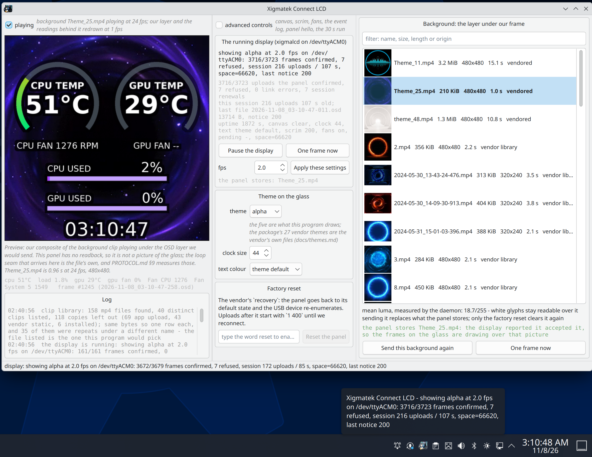
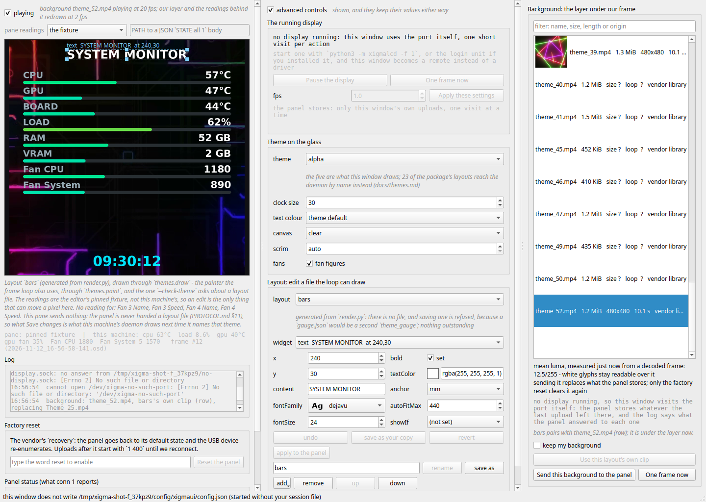

# xigmalcd — system stats on the Xigmatek Connect AIO's built-in LCD


Linux counterpart of the Windows `ALPHA` app that ships with Xigmatek **Connect**
series AIO coolers. Those coolers have a 480×480 LCD in a USB port header on the
water block; on Windows the vendor app draws CPU/GPU temps, clocks and fan speeds on
it. On Linux the panel shows up as a plain CDC-ACM serial port (`/dev/ttyACM0`) and
nothing talks the protocol — until now.

This repo draws the same information from Linux sensors and pushes it to the panel as
PNG frames. Verified on real hardware (Connect 360, firmware `V1.2.3`): handshake,
metrics blob and picture upload all work from Kubuntu — the drawn frame is what the
display shows.

**Unofficial, and it says so.** Nothing here is affiliated with, endorsed by or
approved by XIGMATEK; `Xigmatek`, `Connect` and `ALPHA` are their owner's names. The
code — `xigmalcd/`, `xigmaui/`, `tools/`, `install/` — is GPL-3.0-or-later (`LICENSE`),
and the vendor's own files this repo carries as evidence and test assets are labelled
as such wherever they appear ("Licence", at the end).

## What it draws

Five themes, each drawn over a *different* clip from the vendor's own library, and filmed
moving: the digits, the meters and the clock on the glass all change as you watch. What
they show is recorded, not invented — `docs/videos/readings-2026-11-08.json` holds 12
real `sensors.collect()` readings, one per second, taken on the author's bench while
seven parallel clip decodes were running, which is the load rendering these videos puts
on a machine. CPU 68 → 74 °C, CPU load 57.7 → 94.6 %, fan 1 540 → 2 181 RPM, clock
`00:25:16` → `00:25:28`. That box never went idle while this was written — the session
making the videos runs its own model server at about 390 % of 24 cores — so the `gauge`
ring spends the clip near the top of its measured 30..75 °C scale. It is a busy machine,
and the file says so.

| `alpha` (default) over `Theme_25.mp4` | `gauge` over `3.mp4` |
|---|---|
| https://github.com/user-attachments/assets/79094fe1-e2e9-4ce0-9f81-3f3f3ee123e0 | https://github.com/user-attachments/assets/da2cbb5a-cb17-4121-b4c4-f1f53c9cc3ce |

| `dual` over `Theme_30.mp4` | `bars` over `theme_52.mp4` |
|---|---|
| https://github.com/user-attachments/assets/598e1e53-1775-407b-bd25-576b55082bd6 | https://github.com/user-attachments/assets/57e582b7-73c5-42b1-9437-9ede6cf18f18 |

| `clock` over `Theme_07.mp4` | |
|---|---|
| https://github.com/user-attachments/assets/ce8cab80-2125-4011-b44a-9a4e19a08ca3 | |

`clock` runs over a bright clip (mean luma 176 of 255), which is why its lettering
carries a dark plate behind it — the same rule the window applies, described in
[docs/gui.md](docs/gui.md). The sixth video, the same `alpha` clip with the lettering
drawn in `#ffc400` instead of white, is at the bottom of [docs/gui.md](docs/gui.md).

Videos rather than GIFs, because an `.mp4` written into markdown as an image becomes an
`` tag no browser plays — so these went up through GitHub's own editor, which stores
the file on its CDN and writes the URL into the cell. The originals stay in `docs/videos/`,
and the two things are the same bytes: fetching those six URLs answers with the tree's
files `cmp`-clean, sizes and sha256s included ([docs/limits.md](docs/limits.md) keeps that
measurement), so every figure quoted here and there was read out of what you are watching.
Each one is 10–12 s at the clip's own frame rate; `tools/preview_gif.py` makes them through
the same path the window's preview pane uses, and [docs/tools.md](docs/tools.md) carries the
command. Whether they animate on your screen is your browser's motion setting, not a switch
in this repository.

`alpha` is the vendor's currently selected theme redrawn widget for widget, with the
things that theme has no widget for added: a GPU-temperature column, a gauge arc
around each temperature (30-100 °C, position *and* colour carrying the value), a clock
with seconds, and one fan figure under each temperature. [docs/themes.md](docs/themes.md)
has the identity claim, the geometry and why the digits are that size;
[`themes/alpha/`](themes/alpha) holds the vendor's whole library — 27 themes, their
decrypted layouts, their clips and their baked overlays, every byte hashed — and the
contact sheet of it is
[`docs/previews/alpha-themes-480X480.png`](docs/previews/alpha-themes-480X480.png).
The daemon can draw 23 of those 27 layouts as they are - `xigmalcd --theme Theme_07` -
and `xigmalcd --list-themes` prints that set, the four refused on canvas with the reason,
and the one metric this box has no reading for; `--check-theme Theme_07` reports one of
them the way the loop sees it - which file answers the name, what draws from this
machine's readings, and what is skipped. They reach the panel as ordinary
transparent frames: a layout file is never sent, because this firmware does not read one
(PROTOCOL.md §11).

## The window

The same controls in a Qt application: pick a theme, pick a background from every clip
the machine can find, watch the preview, put one frame or the whole loop on the glass.
And because this panel cannot be asked what it is showing, the window says what it
*knows*: the background the running display reported putting there, and the last six
things it did on the port. Three columns — preview, controls, clip library — with an
`advanced controls` switch that folds the secondary knobs away without changing their
values, a `playing` box that decodes the background in sequence so the preview moves
under our layer instead of showing one still frame of it, and one row that is always in
sight, for the colour of the text it draws. This is a capture of the real program
(`tools/screenshot.py`, no panel attached), with this machine's live readings in the
preview:

Behind the `advanced controls` switch there is also a row that opens one of the vendor's
layout files — or one of the five themes generated from our own drawing code — and edits
the fields this program's painter actually reads, with the picture under the preview
redrawn from the file as it changes. The panel is never handed a layout file, so what that
editor changes is what a loop on *this* machine draws the next time it names that theme
([docs/gui.md](docs/gui.md) has the row and its limits).


And these are real captures from live system (simple vs advanced mode):





It talks to a display loop that is already running when one is running, and drives the
port itself when nothing is — which is the part that needs care, because the panel
allows exactly one opener. [docs/gui.md](docs/gui.md) is the whole write-up: what every
button sends on the wire, what the window stores between runs, what it costs to run,
and the glass ledger for it with the log file each number came from.

## Quick start

### 1. Debian, Kubuntu, Ubuntu: install the `.deb` files

```bash
# 1. get the two files - the releases page in a browser, or with gh:
gh release download --latest --pattern '*.deb'
# 2. install both from one command line (building them instead is docs/packaging.md):
sudo apt install ./xigmatek-connect-lcd_*_all.deb ./xigmatek-connect-lcd-themes_*_all.deb
# 3. the udev rule is installed but not read yet - replug, or:
sudo udevadm control --reload-rules && sudo udevadm trigger --action=change
# 4. the install *enables* the unit and does not start it:
systemctl --user start xigmalcd.service
xigmaui                                     # the window; needs `sudo apt install python3-pyqt6`
```

That gives `/usr/bin/xigmalcd`, `/usr/bin/xigmaui` and `/usr/bin/xigmalcd-reset`, a
udev rule that makes the port a user-owned `/dev/xigmatek-lcd` and keeps ModemManager
off it, and a user unit whose `ExecStart` is `--theme alpha --fps 2` with no reset
permission. The second package is the vendor's own theme library and is optional on
purpose. Two things about that unit are worth knowing on day one: the install enables it
in systemd's **global user** scope (`/etc/systemd/user/default.target.wants`, so for every
user's next login - taking that back is `sudo systemctl --global disable xigmalcd`), and an
**upgrade** while you are logged in has been seen to start the display on its own three
seconds after apt finished. `systemctl --user stop xigmalcd` frees the port at any point.
Everything else an install does and does not do — including the udev reload above — is
measured and written down in [docs/packaging.md](docs/packaging.md), with the transcripts.

### 2. Any other Linux distribution: run it from this tree

```bash
python3 -m xigmalcd --list                    # find the port and its USB description
python3 -m xigmalcd                           # default theme, 1 fps, the vendor's cadence
python3 -m xigmalcd --fps 3 --clock-size 34   # tighter clock, bigger digits
python3 -m xigmalcd --dry-run /tmp/frames --once   # a PNG, and the port never opened
python3 -m xigmaui                            # the window (needs PyQt6)
python3 -m xigmalcd --status                  # ask the running display what it shows
```

Needs Python 3.9+, [pyserial](https://pypi.org/project/pyserial/) and
[Pillow](https://pillow.readthedocs.io/) — on a Debian-family box
`sudo apt install python3-serial python3-pil`. `/dev/ttyACM0` is `root:dialout`, so be
in that group or install the rule; both recipes, and how to run it at login on a
systemd-less machine, are in [docs/install.md](docs/install.md). The window's extra
dependency is PyQt6 (`pip install .[gui]`), which the display loop never needs.

The default run uploads the theme's background first (`media/Theme_25.mp4`, 215 KB) and
then draws on a **transparent** canvas, so that background keeps playing behind the
picture — which is how the vendor's own app does it, and the pair is what its own config
names, so the default glass is what `ALPHA` showed you on Windows.

## Where the detail lives

| | |
|---|---|
| [docs/install.md](docs/install.md) | requirements, the port and the udev rule, `pip install`, running it at login |
| [docs/usage.md](docs/usage.md) | every `xigmalcd` flag, what goes on the wire and when, one port between two processes |
| [docs/gui.md](docs/gui.md) | the window: controls, what each action sends, settings, cost, glass runs |
| [docs/themes.md](docs/themes.md) | what `alpha` is a redraw of, the ring geometry, the vendor library |
| [docs/packaging.md](docs/packaging.md) | the two `.deb` files, `lintian`, CI, install transcripts, reproducible builds |
| [docs/tools.md](docs/tools.md) | what every script in `tools/` is for, and which question it answers |
| [docs/limits.md](docs/limits.md) | what has been seen on glass, by whom, in how many frames — and what has not |
| [docs/troubleshooting.md](docs/troubleshooting.md) | a panel stuck white, and the one command that brings it back |
| [PROTOCOL.md](PROTOCOL.md) | the wire: the handshake, the frame format, the media upload, the session limit — every claim from a capture |

Everything in those files is measured on the author's bench or read out of a kept log,
and the gaps are named as gaps. `tools/selftest.sh` runs the twenty offline sections
that hold the claims which do not need hardware — it is what CI runs first, on a machine
that has never seen a panel.

## How the protocol works

See **[PROTOCOL.md](PROTOCOL.md)** — frame format, the checksum rule, the vendor's
escaping (`0x5A` → `5B 01`, `0x5B` → `5B 02`, counted nowhere), how replies are matched
to requests (`AckNumber = SeqNumber + 1`), the command set, the upload sequence, the
session limits, and how to read the vendor app yourself. It is written out of captures of
the Windows app talking to this panel, and the offline suite re-checks that code against
those same captures: **181** host→panel frames re-encoded with **0** disagreeing with
`xigmalcd/protocol.py`, and **267** replies read against the checksum rule with all of
them passing.

`xigmalcd/protocol.py` is the implementation; `xigmalcd/sensors.py` reproduces the
metrics schema; `xigmalcd/render.py` is the drawing; `xigmalcd/main.py` is the loop;
`xigmaui/` is the Qt window over the same four modules.

## Licence

GPL-3.0-or-later for the code, with the vendor's own files carved out and labelled
where they came from. [LICENSE](LICENSE) is the license text;
[debian/copyright](debian/copyright) is the machine-readable version of the same
distinction, and it names what was done to obtain the vendor's files rather than
pretending to license them. If the rights holder of XIGMATEK's files considers their
inclusion wrong, say so at the address in that file's `Upstream-Contact` and they come
down.

## Credit

The protocol was recovered by watching the Windows app talk to a panel that this
project then drove from Linux; the notes on how, and the captures themselves, are in
[PROTOCOL.md](PROTOCOL.md). [docs/handoff-2026-11-05.md](docs/handoff-2026-11-05.md) is
the record of how that discovery went, kept as history rather than as current state.
