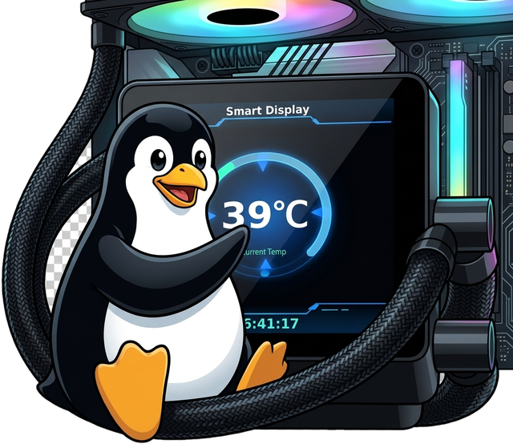
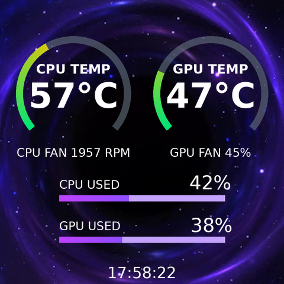
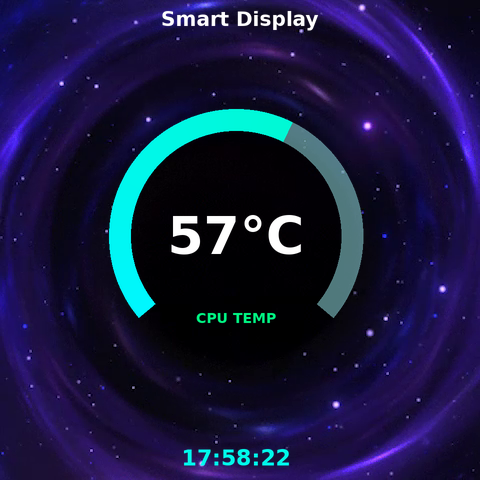
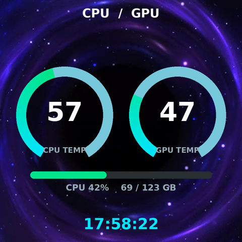
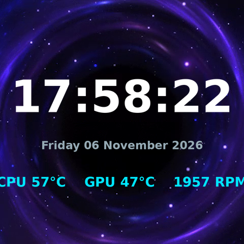
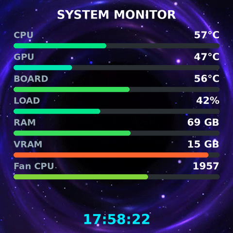

# xigmalcd — system stats on the Xigmatek Connect AIO's built-in LCD



Linux counterpart of the Windows `ALPHA` app that ships with Xigmatek **Connect**
series AIO coolers. Those coolers have a 480×480 LCD in a USB port header on the
water block; on Windows the vendor app draws CPU/GPU temps, clocks and fan speeds on
it. On Linux the panel shows up as a plain CDC-ACM serial port (`/dev/ttyACM0`) and
nothing talks the protocol — until now.

This repo draws the same information from Linux sensors and pushes it to the panel as
PNG frames. Verified on real hardware (Connect 360, firmware `V1.2.3`): handshake,
metrics blob and picture upload all work from Kubuntu — the drawn frame is what the
display shows.

**Unofficial, and it says so.** Nothing here is affiliated with, endorsed by or
approved by XIGMATEK; `Xigmatek`, `Connect` and `ALPHA` are their owner's names. The
code — `xigmalcd/`, `xigmaui/`, `tools/`, `install/` — is GPL-3.0-or-later (`LICENSE`),
and the vendor's own files this repo carries as evidence and test assets are labelled
as such wherever they appear ("Licence", at the end).

The previews below are the transparent OSD frames composited over one frame of the
vendor's own background MP4 - the same two-layer picture the panel puts on the glass.

| `alpha` (default) | `gauge` |
|---|---|
|  |  |

| `dual` | `clock` |
|---|---|
|  |  |

| `bars` | |
|---|---|
|  | |

`alpha` is the vendor theme made by redrawing, widget for widget, the theme the vendor app
currently has selected on this panel (`store.json` → `currentThemeId 1785506775818` =
`presetTheme[26]`: big CPU temperature, CPU and GPU usage with bars), with things that
theme has no widget for added: **GPU temperature** in its own column next to the CPU
one, a **gauge arc around each temperature** (30-100 °C, the fill's position *and* its
colour carrying the value - green at 30 °C, amber at 62, red at 100), the **system clock
with seconds** along the bottom, and **one fan figure under each temperature**.  That
selected theme is now identified exactly rather than inferred: the app's 27 `presetTheme`
entries pair one-to-one with the 27 theme files the installer ships, and entry 26 is the
vendor's `1757491589871`.  The whole library - layouts, clips, baked overlays, decrypted
with the app's own constants - is in `themes/alpha/`, and that directory's `README.md`
writes up the container, the cipher and the layout schema.  The two
temperature columns are deliberately alike - same label size and weight, one shared size
for both numbers, chosen from whichever reading is wider, so neither can end up bigger
than the other.  Each reading sits inside its ring's hole: at 97 px outer radius the two
rings fit side by side with a 38 px gutter, and that hole is what sizes the text - label
22 (the vendor's own 32 will not clear the stroke), value 58, or 46 the moment a
three-digit temperature appears.  A missing reading draws no arc and reads `--°C`, and a
fan with no reading reads `CPU FAN -- RPM` rather than going quiet.  See
`xigmalcd/render.py` for the measured geometry (the ring's open-bottomed shape is the vendor
skin's own - 269° of solid ink from 136° to 45° on its captured frame - drawn here at 260°
from 140°), `tools/selftest.sh` for the check that keeps text off
the stroke, and "Notes and known limits" for what the fan figures can honestly show on a
given board. Its background default is `media/Theme_25.mp4` - the clip
the vendor app itself pairs with that theme - so the default picture is the Windows pairing,
and it needs no extra plate behind the glyphs because it is dark (see `--scrim` below).

## Quick start

```bash
python3 -m xigmalcd --list             # find the port
python3 -m xigmalcd                    # default theme, 1 fps, the vendor's rate
python3 -m xigmalcd --fps 3 --clock-size 34      # tighter on the clock, bigger digits
python3 -m xigmalcd --no-mp4          # keep the panel's stored background as it is
python3 -m xigmaui                     # the same controls in a window (needs PyQt6)
python3 -m xigmalcd --status          # ask the display that is already running what
                                      # it is showing: the port is never opened
```

The default run uploads the theme background first (`media/Theme_25.mp4`, 215 KB) and
then draws on a **transparent** canvas, so that background keeps playing behind the picture
- which is how the vendor's own app does it, and the pair is what its own config names, so
the default glass is what ALPHA showed you on Windows. `--bg black` paints an opaque field
over the background instead; `--no-mp4` skips the upload and uses whatever the panel already
has stored. Two other vendored clips are one flag away: `--mp4 media/Theme_11.mp4` (3.4 MB,
the quietest loop in the vendor's library) and `--mp4 media/theme_48.mp4` (1.33 MB, nearly
white under white glyphs, which is why a `--scrim` plate is drawn automatically for it).

Choose the rate deliberately: the glass shows the newest frame the panel has *committed*,
so what you see is up to one frame period old - the seconds digit runs ~1 s behind at
1 fps and stops looking behind at 3 fps. 1 fps is the vendor's cadence and its write
count; every frame is one `transport`/`transported` pair, and the ordering inside that
pair is not cosmetic, see "Notes and known limits".

Requirements: Python 3.9+, [`pyserial`](https://pypi.org/project/pyserial/),
[Pillow](https://pillow.readthedocs.io/). On Kubuntu/Debian:

```bash
sudo apt install python3-serial python3-pil
```

`/dev/ttyACM0` is `root:dialout`, so either be in the `dialout` group
(`sudo usermod -aG dialout $USER`, then log out/in) or install the udev rule:

```bash
sudo install -m 0644 install/99-xigmatek-lcd.rules /etc/udev/rules.d/
sudo udevadm control --reload-rules && sudo udevadm trigger --action=change
```

The rule also creates a stable `/dev/xigmatek-lcd` symlink (ACM numbering changes when
the panel re-enumerates) and sets `ID_MM_DEVICE_IGNORE` so ModemManager does not fire
AT commands at the display. Then:

```bash
python3 -m xigmalcd --device /dev/xigmatek-lcd --theme gauge
```

Everything here also installs as a package, and the two halves install separately on
purpose: `pip install .` gives the display loop and the `xigmalcd` command, `pip install
.[gui]` adds PyQt6 and the `xigmaui` command with it. Qt is an extra because the loop that
holds the port runs without it - the same reason `install/install.sh` only checks
`import PyQt6` and names `python3-pyqt6` when it is missing, rather than installing Qt for a
headless box. Both packages are shipped (`xigmalcd` and `xigmaui`), and `tools/selftest.sh`
reads `pyproject.toml` to keep that true: both packages listed, PyQt6 in the extra and not in
the base dependencies, and both console-script targets resolving to something callable. Run
from a checkout, the commands are `python3 -m xigmalcd` and `python3 -m xigmaui` either way.

## Run it at login

```bash
install/install.sh                     # deps + port check + systemd user unit + menu entry
XIGMALCD_THEME=clock XIGMALCD_FPS=1 install/install.sh
install/install.sh --udev              # also installs the udev rule (sudo)
install/install.sh --no-desktop        # headless box: skip the window's menu entry
```

That writes `~/.config/systemd/user/xigmalcd.service`, enables it, and starts it
immediately. Check on it with
`journalctl --user -u xigmalcd -f`, stop it with
`systemctl --user disable --now xigmalcd`. To run it without a graphical session,
`loginctl enable-linger $USER`.

When PyQt6 imports, it also writes the window's menu entry,
`~/.local/share/applications/xigmaui.desktop`,
pointed at `install/xigmaui.png` (the icon is the project's mark - the penguin at
`install/artwork/xigma-penguin.jpg`, with the transparency checkerboard that the JPEG
carries painted into it turned into real alpha by `tools/makeicon.py`, which also writes
`install/xigmaui.ico` with 16 px through 256 px.  `tools/makeicon.py --draw` still makes
the other icon: the picture the glass actually shows, drawn with the same `render.draw`
the daemon uploads from, over a frame of `media/Theme_25.mp4`, which is the one to look at
when the question is whether the display code is right.  The window sets the same file as
its own icon, which is why the `.desktop` entry names it by path instead of an icon-theme
name). The installer regenerates that PNG only if it is
missing or empty, and then validates the entry with `desktop-file-validate` when that
command exists, so a broken `.desktop` is caught at install time rather than by a menu
that silently shows nothing. `tools/selftest.sh` checks the shipped `.png` and validates
the template the same way, with no install step involved. The entry has one extra
action, **Start in the tray only** (`python3 -m xigmaui --hidden`), for when the window
is a control panel you keep out of the way; it needs a desktop with a tray, and the
same two checks cover it.

**One process can hold the serial port, so the unit holds it and the window is
its client.** `xigmalcd` listens on a control socket while it draws
(`$XDG_RUNTIME_DIR/xigmalcd.sock`), and the menu entry talks to it there: pick a
theme, upload a background, pause the frame loop, read the counters, all while the
glass stays live. Nothing has to be stopped to use the window any more, and the
display keeps drawing when the window is closed - it hides to the tray, whose menu
has the display's status line, pause/resume and the five themes. See "Two
processes, one port" below for what the socket accepts and what it refuses.

## What the panel gets

Two things, in this order:

1. `STATE all 1` — a JSON metrics blob with the same schema and units the Windows app
   uses (cpu/gpu/disk/memory/network/fans/motherboard). It matches the
   `attribute:["Status","Fan","Pump"]` the panel reports, i.e. the pages it says it has;
   this project has never seen those pages render (our OSD covers the screen and there
   is no readback), so that is the vendor's intent, not an observed behaviour. Sent
   **twice at
   startup**, like ALPHA does: the panel stops answering the picture channel if it is
   fed metrics continuously, so `--state-every` exists but defaults to off.
2. One PNG per frame — rendered at 960×960 and downscaled for clean type, uploaded as
   `<timestamp>.osd` through the media transfer channel. The loop never waits on the
   panel: 40 KB was handed to the kernel in ~50 ms, the panel confirms each file ~100 ms
   later while the next frame is being drawn, and `--fps` is the metronome. (That write
   timing was measured when frames went up as RGBA; they are about 12 KB now, and the
   write has not been re-timed.) The stock files from the Windows app are 480×480 8-bit
   RGBA PNGs (~24 KB). Ours are the 256-colour file on either canvas, transparent or
   opaque: **12.2 KB** for one ringed `alpha` frame offline, 12 322-13 372 B a frame in
   the first window run with that default. The choice was made on glass, not on the
   offline numbers - the same frame went up both ways at 1 fps, **61 of 61** frames each,
   42 560-46 415 B against 12 169-12 401 B, and what the offline numbers predict (a gauge
   ramp drawn in 80 colours coming back in 13) was not visible from the chair.
   `--truecolor` puts the exact 8-bit RGBA file back on the wire, where the alpha of the
   half-transparent gauge track is kept to the unit ("Notes and known limits", §11).

Sensors on this machine: `k10temp` (Ryzen Tctl), `amdgpu` (iGPU power/voltage),
`nvme` and `r8169` via hwmon, `nvidia-smi` for the discrete GPU, `/proc` for load,
memory and network rates, and the board's Nuvoton NCT6687D tachometers once
`sudo modprobe nct6683` has bound them — that is what makes `CPU FAN nnnn RPM` real
(`tools/fanscan.py` lists the channels and shows how the CPU one was identified).
Put the module in `/etc/modules-load.d/` if you want it at every boot.

## Options

| flag | meaning |
|---|---|
| `-d, --device PATH` | serial port; default is the first `/dev/ttyACM*` |
| `-b, --baud N` | 115200 (the panel's only rate) |
| `-t, --theme NAME` | `alpha` (default), `gauge`, `dual`, `clock`, `bars`. `alpha` is the theme the vendor app currently has selected (`presetTheme[26]` in its `store.json`), redrawn from that file's own widget geometry, with a GPU-temperature column matched to the CPU one, a 30-100 °C gauge arc around each temperature (green through amber to red), a seconds clock and one fan figure under each temperature |
| `-f, --fps N` | frames per second. 1 is the vendor app's rate and its write count. Higher rates are real, not wasted: the glass takes the newest frame it has committed, so the picture you see is up to one frame period old - the on-screen clock runs ~1 s behind at 1 fps and stops looking behind at 3 fps, and the panel accepted **361/361** frames in one 120 s window and **1173/1175** in a 400 s soak at 3 fps; the ringed `alpha` picture, which is the biggest frame this code sends (39 400-45 244 B), took 3 fps too - **91 of 91** in 30 s. Choose it for the write count you are willing to spend (86 400 uploads a day at 1 fps, 259 200 at 3) |
| `--duration N` | stop after N seconds |
| `--once` | push one frame and exit |
| `--dry-run DIR` | render to PNGs in DIR, never touch the port (test a theme) |
| `--bg clear\|black` | `clear` (default) draws on a transparent canvas, so the panel's own background layer keeps playing behind our glyphs - the way ALPHA's `.osd` files do, which paint 4.6 percent of their pixels. `black` is the old opaque picture, which covers that layer completely |
| `--mp4 [PATH]` | upload a 480×480 H.264 MP4 as the panel's background layer at session start, as ALPHA does with its theme background. **On by default**, with `media/Theme_25.mp4` from this repo (214 917 B, 23 frames at 24 fps, a 0.96 s loop, byte-identical to the copy `currentThemeBg` names in `%APPDATA%/alpha`, mean luma 18.7 of 255 so it is dark under white glyphs, 0 black frames). Its measured weakness is the loop join: 2.50 against 1.51 typical frame-to-frame motion, i.e. a small jump once per second. It is the default because it is the vendor's own pairing, not because it measures best; the two measured-quieter vendored clips are one flag away - `--mp4 media/Theme_11.mp4` (3 402 098 B, 363 frames at 24 fps, a 15.1 s loop, luma 13.3-24.1, 0 black frames, join 0.11 against 2.54 - the smoothest loop in the vendor's library, taken in **2.4 s**) and `--mp4 media/theme_48.mp4` (1 333 649 B, 10.85 s, luma 227.3, a near-white field for white text and a join of 4.50 against 0.60, hence the automatic `--scrim`). All figures come from decoding all 40 vendor clips, not from sampling ("Where the defaults come from"). `Theme_24.mp4` in the vendor tree is the smallest upload that still reads seamless (0.94 MB, 4.04 s, join 1.55 vs 2.93) |
| `--no-mp4` | skip the upload and leave the panel's stored background playing. The panel plays the last media file it took, so what is stored now is whatever the last run uploaded (`Theme_25.mp4` after the 11:04 run); only `tools/reset_panel.py --yes` clears it, which puts the still logo back |
| `--clock-size N` | how tall the clock's digits are, in pixels, for themes that draw one. Default 26 of the panel's 480 |
| `--gauge-source temperature\|load` | what the arc follows. `temperature` is what ALPHA uses, and on an idle desktop CPU it barely moves (across ALPHA's own 65 captured frames the tip travelled 14 degrees in 43 s); `load` follows CPU busy percent, which moves every second |
| `--cold N`, `--hot N` | the gauge's scale. Default 30/75, measured off ALPHA: its digits read 57 °C at 55-61 percent of the sweep |
| `--title TEXT`, `--label TEXT`, `--no-clock` | what the picture says. Themes without a heading ignore `--title`; `--label` defaults to `CPU TEMP`, or `CPU LOAD` with `--gauge-source load` |
| `--scrim A` | alpha 0-255 of the dark plate drawn behind the glyphs. Unset is automatic: no plate over the shipped dark default (luma 18.7), a plate at `SCRIM_ON_BRIGHT` 150 over a vendored clip measured brighter than mid-grey (`theme_48.mp4` is 227, white on white without it), no plate for `--bg black` or an unmeasured clip. Every glyph is white because the vendor's are (`textColor` `rgba(255,255,255,1)` throughout `store.json`) |
| `--order notice\|fast` | when `transported` goes out. `notice` (default) holds it until the panel's own file notice lands, which is the order ALPHA's traffic has and the only order that makes the glass redraw every frame; `fast` sends it right after the last file byte, and the panel answers that 1 time in 6 and the picture jumps (`tools/order_probe.py`, PROTOCOL.md §6) |
| `--truecolor` | put the exact 8-bit RGBA PNG on the wire instead of the 256-colour file that is the default on **every** canvas. Costs 3.4× the bytes — on glass one ringed `alpha` frame measured **42 560-46 415 B against 12 169-12 401 B** (means 43 782 B against 12 289 B) — and it is the only shape that keeps the half-transparent gauge track's alpha to the unit. What the default gives up is in `tools/selftest.sh`'s prints: the gauge ramp drawn in 80 colours coming back in 13, and 74 of 11 149 fully opaque pixels keeping alpha 255. Both shapes went up **61 of 61** frames at 1 fps and the owner could see no difference from the chair, which is why RGBA is the opt-in (PROTOCOL.md §11) |
| `--palette` | spell the default out: the 256-colour PNG, over a transparent canvas as over an opaque one, which is what `xigmaui/panel.py` has always uploaded. Kept so older command lines and README's encode A/B/A windows mean what they say; `--truecolor` wins if both are given |
| `--colors N` | palette size for the indexed file (default 256) |
| `--chunk N`, `--gap S` | raw upload chunk size, and the one pause between the `transport` announcement and the first file byte (the vendor app: 1000 bytes; the pause is 0.02 s and see §6 before setting it to 0) |
| `--overlay` | old name for `--bg clear`, kept so earlier command lines still work |
| `--no-state` | skip the metrics blob entirely |
| `--state-every N` | refresh metrics every Nth frame (see the caveat above) |
| `--no-fans` | leave fans out entirely: no `fans` section in the metrics blob, and no fan figures on the picture |
| `--metrics-file PATH` | draw the picture from the sections of a JSON `STATE all 1` body instead of this machine's readings, re-read whenever the file changes. For the layouts the sensors will not produce: the red end of the gauge ramp, a three-digit temperature, a column with no reading. Picture **only** - while anything is pinned the loop sends no metrics blob at all and `--state-every` is refused out loud, so the panel is never handed a number this machine did not measure. Fixtures in `tools/metrics/`, watched windows and wire sizes under "Notes and known limits" |
| `--no-sleep` | set the panel's idle timeout to 0 so it never blanks the screen (default: vendor's 60 s) |
| `--session-max N` | renew the serial session every N uploads (default 500, 0 = never) |
| `--session-ttl N` | also renew it every N seconds of session life (default 300, 0 = never) |
| `--socket PATH` | where to listen for control requests while drawing. Default: `$XIGMA_SOCKET`, else `$XDG_RUNTIME_DIR/xigmalcd.sock`, else `/run/user/UID`, `~/.local/run`, `/tmp/xigma-UID.sock`. The directory is created 0700 and the socket chmodded 0600, and the peer's uid is checked with `SO_PEERCRED`. See "Two processes, one port" |
| `--no-control` | do not listen on a control socket at all (also implied by `--once`: a single frame has nothing to control, and a socket left behind by a finished run would only invite a client to knock on a dead link) |
| `--allow-reset` | let the control socket reach `recovery`, which re-enumerates the USB device and drops the stored background. Off by default; `tools/reset_panel.py --yes` stays the deliberate way |
| `--status` | ask the display that is already running what it is showing, print it, exit. One line on the control socket: the serial port is never opened, so this works while the loop runs. Exit 1 with "no display answering" when nothing is listening |
| `--list` | list candidate ports with their USB descriptions |
| `-v, --verbose` | log every frame in both directions |

## Two processes, one port

`/dev/ttyACM0` allows exactly one opener (PROTOCOL.md §1), so a service keeping
the glass updated and a desktop window choosing what goes on it cannot both have
the port. The way round it is a control socket: **the display process owns the
serial line and the frame loop, and everything else is a client of it**
(`xigmalcd/control.py`, and `xigmaui/daemon.py` is the window's half).

The socket is a unix socket at `$XDG_RUNTIME_DIR/xigmalcd.sock` (see `--socket`
for the fallback chain), directory 0700, socket 0600 whatever the umask says, a
stale socket from a dead run replaced rather than treated as a conflict, and the
peer's uid checked with `SO_PEERCRED` even though the file mode already excludes
other users. That is defence against another ordinary user on this machine, and
nothing more: a process running as you could already open the port itself.

```
$ python3 -m xigmalcd --status
showing alpha at 1.0 fps on /dev/ttyACM0: 24/24 frames confirmed, 0 refused, session 24 uploads / 23 s, space=61472, last notice 200
  settings: theme alpha, canvas clear, clock 26, scrim auto, title CLI --status
  counters: 24/24 uploads the panel confirmed, 0 refused, 0 link errors, 0 session renewals, this session 24 uploads 23 s old
```

That is a real answer, taken out of `data/glass/2026-11-06-161444-socket-run.txt`: the
`--status` client ran against a display that was mid-run at 1 fps, and nothing about the
display changed because it asked.

One JSON object per line in each direction, and the same fields back:

| command | what it does |
|---|---|
| `status`, `config` | the loop's counters (a copy, so a client reading mid-upload never sees a counter change underneath it) and the effective settings. `refused` counts the **frame** uploads the panel threw away, whether its `1 400` came back as a notice or reached us as an exception - the two used to disagree, which is how a log with four refusals in it read `0 refused`. A refused **background** is not in that number: it is reported in the daemon's own events (`background <name> did not land`), because it is not part of the picture loop. `errors` is a streak - the consecutive failures the loop is sitting on right now, back to 0 after the next accepted frame or recovery - and not a total |
| `theme`, `fps`, `clock_size`, `bg`, `scrim`, `fans`, `title` | change the settings the loop re-reads every frame, on the daemon's own argparse object. Bounds: fps 0.1-5.0, clock 8-120, scrim 0-255 or `auto`. `fans` is one switch with the daemon's two effects - the line on the picture and the `fans` array in the metrics blob |
| `pause`, `resume` | nothing goes out on the wire while paused, so the panel keeps the last picture it was given. `resume` re-helloes, and re-opens the port if the pause outlasted `--session-ttl`, which is the clock the measured silence arrives on (§9). A short pause only needs the hello, which is also what wakes a blanked panel |
| `upload PATH`, `frame` | **queued, not performed**: the server thread leaves one request in a one-slot slot and the frame loop - the only thread that touches the port - carries it out on its next iteration. A second upload while one is waiting is refused rather than stacked |
| `reset` | refused unless the daemon was started with `--allow-reset` |
| `quit`, `stop` | refused: stopping the display is `systemctl --user stop xigmalcd`, which is reversible in a way a menu click is not |

What it refuses, and why that is written into the server rather than left to the
client:

* **anything firmware-shaped.** `.zip`, `.bin`, `.img`, `.tar`, `.gz`, `.hex`,
  `.elf` are refused by name and the refusal says why: the update path is
  `type: "firmware"` (§7), which nothing in this project sends, and a socket must
  not become a route to it. Files over 8 MB are refused as past the largest thing
  the vendor app has ever pushed here (3.4 MB); only `.mp4`, `.png` and `.osd` are
  accepted, and an empty file is a mistake rather than a picture.
* **`recovery` by default**, because it re-enumerates the USB device and clears
  the stored background (§9). `Link`'s own destructive guard is decided when the
  port is opened, so a daemon started without `--allow-reset` cannot reach that
  even from its own loop thread.
* **a refusal is never reported as silence.** Both the client and the window
  distinguish "the display answered `no`" from "nothing is listening", because
  those mean opposite things and are cured by opposite things.

`--status` is the same client from the command line, and `tools/selftest.sh`
exercises the socket end to end: bounds, the one-slot queue, the `.zip` refusal,
the `reset` refusal, junk from a client, a second daemon refused on a live socket,
a failed run leaving no socket behind, and the window driving a display over a
real socket with the serial layer absent. Cost, measured there: the window's
Apply button, six socket commands, in **1 ms** - a control command never waits on
the panel, because the daemon's server thread only touches in-process state.

The gap worth knowing about: **nothing here has been run for hours.** Five 520 s windows
at 1 fps have now been driven through the socket on real glass to their own end, each
renewing its session at `--session-ttl` (300 s) and carrying on drawing - 496 of 496
confirmed, 492 of 496, 496 of 496, 498 of 498, and 496 of 498 in the one run after the
alpha theme's gauge rings went in; PROTOCOL.md §9 and §11. That is past the ~370 s at which an
unrenewed session
goes silent.
A sixth window was watched and stopped by hand at 5 min, so it counts for the phases it
reached and not for duration. Beyond that nothing has been measured: no run has been left
up overnight, and no session has been left paused past its `--session-ttl`, which is the
case that needs the port reopened rather than the hello. `journalctl --user -u xigmalcd` is
where a long run would first be seen.

## Tools

**Which tool answers which question.** The list below says what each tool is; this is the
way in from a symptom. Nothing here sends firmware-shaped traffic, and the only tool that
touches `recovery` is `reset_panel.py`, which you invoke by hand.

| If the question is | run | what it answers |
|---|---|---|
| is the panel healthy after a boot or a reset? | `tools/state.py`, then `tools/bootcheck.py` | the `conn` snapshot, read-only; then two small and two full uploads. `logo`/`mode` at `2147483647` means it is not healthy |
| did my edit break the wire format? | `tools/selftest.sh`, then `tools/verify_protocol.py COM3_windows_dumps/*.txt` | fifteen offline sections with no hardware, then every captured Windows frame re-encoded and diffed: **130 frames, 0 mismatches** |
| does this firmware know that topic at all? | `tools/fuzz.py`, `tools/probe.py` | no answer = no topic, `400` = topic exists and the body was wrong, `200` = the JSON parsed — which is not the same as the write landing |
| will the panel take *my* file? | `tools/send_image.py FILE`; `tools/fileshape.py` if the file's shape is the question | one upload, judged by the panel's own file notice; the second rotates RGBA, indexed, flat and the vendor's own `.osd` files through one session |
| how fast does the glass tick, and why does the clock only move every 20-40 s? | `tools/frame_lag.py`, `tools/indexprobe.py`, `tools/watchtest.py` | a big frame number and the wall clock painted on the glass, so the answer is a glance rather than a stopwatch. Needs eyes on the unit |
| why did uploads go quiet after a few hundred files? | `tools/session_limit.py` | pushes until the panel stops answering, then tries re-handshake, a DTR pulse and a port reopen in that order and says which one worked |
| is the 0.02 s pause before the bytes load-bearing, and is the order of `transported`? | `tools/writebench.py`, `tools/order_probe.py` | both measured on this panel: **361 of 361** at 0.02 s against **0 of 128** at 0 s, and `transported` acked **0 in 8** right after the last byte against **8 in 8** after the notice |
| can the panel draw the numbers itself, with no uploads? | `tools/realtime.py` | answered on this firmware: no — static logo only, the topic is a display-layer toggle |
| which tachometer channel is the CPU fan? | `tools/fanscan.py --watch 90` | which channel moves with the CPU, from sysfs only; never touches a PWM |
| does the always-on model work — display process plus window on one port? | `tools/display_glass.py` | starts the loop, then behaves only as a client of its control socket through every phase, ~9 min, and exits 1 listing what it did *not* show |
| do the window's own buttons work on real glass? | `tools/gui_glass.py` | the same kind of labelled run through `xigmaui.panel.Panel`, the window's own worker |
| what did the vendor app itself actually send? | `tools/log_timeline.py LOG`, `tools/capdump.py`, `tools/vendor_capture.py` | ALPHA's 6-17 MB logs folded into a request sequence, the Windows IRP captures parsed without a Windows box, and the `.osd` payloads taken back out of them |
| the panel is white from the first second | `tools/reset_panel.py --yes` | the vendor's `recovery`, byte-identical to the frame in its own log; the only repair for fields stuck at `2147483647` |
| what would a frame look like, with no panel in the loop? | `python3 -m xigmalcd --dry-run DIR`, `tools/previews.py` | PNGs on disk from the same render path; previews composite over the shipped clip the way the panel composites |
| what are ALPHA's theme files, and what do its themes actually contain? | `tools/thm_unlock.py`, `tools/theme_previews.py` | the `.thm` container opened with the app's own constants: 27 layouts, 44 clips, 27 baked overlays in `themes/alpha/`, every byte hashed; and a sheet showing each theme over its own clip |

* `tools/probe.py` — the body-key question: does the panel validate bodies, and
  which key names does it know?  Walks eight display topics (`logo`,
  `presetThemeId`, `rotate`, `osdState`, `sysinfoDisplay`, `displayInSleep`,
  `realtimeDisplay`, `waterBlockScreenId`) against eleven guessed bodies and reads
  the codes as the oracle: `200` landed, `400` means the topic exists and the body
  did not parse, silence means the firmware has no such topic.  That is how
  `presetThemeId {"index":3}` was found.  The two topics now in
  `protocol.BLOCKED_TOPICS` (`logo`, `presetThemeId`) and `waterBlockScreen*` are
  reported as "not sent" rather than written to, and because the remaining six are
  also writes with no readback the tool needs `--force` to send any of them; without
  it, it prints what a sweep costs and exits 1.
* `tools/send_image.py FILE` — upload any PNG or `.osd` file, with the vendor's
  chunk timing (`--chunk`, `--gap`). An `.osd` goes up byte for byte as it is on
  disk; a PNG is re-encoded through Pillow and re-padded, which is what you want
  for a picture you drew and not what you want to test a captured file with.
  Good for testing whether the panel's decoder accepts your file without touching
  the render code.
* `tools/verify_protocol.py COM3_windows_dumps/*.txt` — re-encode every frame captured
  on Windows and diff it against the capture, byte for byte. On the main capture
  (`COM3 Monitoring Session.txt`) alone: **130 frames, 0 mismatches** (65
  `transport`/`transported` pairs), and `ContentLength` equals the unescaped JSON
  length in 130 of 130; the glob over both captures in that directory reports the
  same zero mismatches over 180 frames (88 pairs). If you change `protocol.py`,
  run this.
* `tools/selftest.sh` — the offline checks: capture round-trip, a render of every
  theme, encode/decode round-trips including the panel's malformed-reply case, the encoder
  switches read out of the PNG each dry run writes, what the indexed file gives up next to
  RGBA, the pinned-metrics promise (a pinned frame draws the far end of the ramp and sends no
  metrics blob at all), the vendor theme library re-hashed against its own manifest (all 152
  files, the dedup rule, the root-vendored clips, the contact sheets, and the
  `store.json`/`.thm` pairing when the Windows volume is mounted),
  `pyproject.toml` read as an installed person would meet it, the
  window's saved-state round-trip, the `.desktop` entry and its icon, the GUI built
  offscreen against a port that does not exist (clip sizes and lumas, five themes
  previewed, the scrim rule, the reset gate, the four panel actions against a stubbed
  `Link`), the wall-clock cost of the window re-measured rather than remembered, and the
  GUI ledger's own numbers re-read out of `data/glass/` so the table in "The GUI" cannot
  quietly become folklore. Needs no hardware, so it is what to run after editing
  `protocol.py`, `render.py` or `xigmaui/`.
* `tools/gui_glass.py` — the GUI's drawing paths against the real glass, in one
  continuous labelled run: status, background upload, one frame, `--live-seconds`
  at `--fps`, with the phase name as the theme title so whatever you saw has a name
  and a slot in the log, and its own start/end clock printed. Goes through
  `xigmaui.panel.Panel`, the window's own worker, and cannot queue `reset`.
  `--no-upload` skips the background overwrite, `--no-fans` also takes the tach array
  out of the metrics blob rather than only out of the drawing, `--mp4`/`--theme`/
  `--clock-size` pick what goes up. Tee its output into `data/glass/` under a name that
  carries the window's date and time: that file is what the README ledger quotes, and
  `tools/selftest.sh` re-reads it.
* `tools/display_glass.py` — the same idea for the other model: it **starts a separate
  `xigmalcd` display process** (given `--duration`, so it cannot outlive the script) and
  then behaves only like a client of its control socket, on a socket of its own
  (`xigmalcd-glass.sock`, never the login unit's). Phases: the loop drawing, `--status`
  from the command line, the window's Apply as the socket speaks it (the six settings
  commands plus a `title` label), `pause`, one `frame`
  asked for while paused, `resume`, a queued background upload, an on-purpose `reset`
  request (refused, because the display was started without `--allow-reset`), and the
  wait for the loop's own session renewal. Each phase names itself on the glass through
  the `title` command, the counters are read back after each one, and the run exits 1
  with a list of what it did *not* show if the pause moved any frame, if the paused
  `frame` drew nothing, if `resume` did not renew, if the upload's notice did not
  arrive, or if no renewal came. Nothing here can send `recovery` — the display is
  started without the flag that would allow it — and nothing sends anything
  firmware-shaped. ~9 min at `--fps 1`, and the log belongs in `data/glass/`.
* `tools/makeicon.py` — redoes the project's mark: `install/xigmaui.png` (256 px, what
  the menu entry and the window use), `install/xigmaui.ico` (the same mark at 16 px
  through 256 px) and `docs/logo.png`.  The source is the committed artwork
  `install/artwork/xigma-penguin.jpg`; because a JPEG cannot carry alpha, the tool
  turns the transparency checkerboard painted into that JPEG into real alpha, keeping
  only the grid the picture's border can reach so the penguin's equally white belly
  survives.  `--draw` makes the other icon instead: the alpha theme drawn by the
  daemon's own `render.draw` over a frame of the shipped clip, numbers pinned, which
  is the one to look at when the question is whether the display code is right.
* `tools/session_limit.py` — push frames until the panel stops answering, then try the
  three candidate cures in order (re-handshake, DTR pulse, port reopen) and report
  which one works. This is how the session-limit behaviour and the cure were pinned
  down; ~6 min at 2 fps, ~9 min at 1 fps.
* `tools/fuzz.py` — the live oracle for unknown topics: no answer means the firmware
  does not know the topic, `1 200` means accepted, `1 400` means the topic exists but
  the body was wrong. The topics in `protocol.BLOCKED_TOPICS` are dropped from its
  table before the first request (`--grep mode` reports that and sends nothing), and
  `recovery` is not in the table at all.
* `tools/vendor_cmds.py` — every command the decompiled vendor app registers, one at a
  time, with the panel's verdict; `--shapes` also probes topics ALPHA registers but never
  calls, `--list` prints the table without touching the port. It no longer sends
  `presetThemeId` (that entry in its old SAFE list is what blanked a unit — see the danger
  note below) and its `--risky recovery` flag is gone: `recovery` belongs to
  `tools/reset_panel.py` only.
* `tools/realtime.py` — `realtimeDisplay {"enable":true}` plus a metrics heartbeat, with
  no uploads during the experiment itself, to ask whether the panel can draw the numbers
  itself. **Answered, on this firmware: it cannot.** The screen showed only its static
  logo; the topic acts as a display-layer toggle (`--disable` to turn it back off), and
  the tool ends by uploading one gauge frame so the glass is left showing something.
* `tools/reset_panel.py` — the vendor app's own reset, one request, sent by exactly one
  hand-invoked tool. Dry run by default; `--yes` sends `POST recovery 1 {"enable":true}`,
  byte-identical to the frame in ALPHA's log at 18:39:48 on 2026-11-05, prints the frame
  first, and then waits for the USB device to come back and re-reads the state. This is
  the only thing that repairs a panel whose `logo`/`mode` sit at `2147483647`.
* `tools/theme.py` — read-only by default: reports `mode`, `logo`, `osdState`, `space`
  (`--watch N` to repeat) and says so plainly when the theme fields are at the panel's
  "not set" value. Writes only with `--force TOPIC VALUE`, and states the cost first.
* `tools/keyprobe.py` — the body-shape oracle that proved those topics are unwritable:
  it tries a key list against one topic and checks the field for a **round trip**, because
  a `200` only means the JSON parsed. The run that settled this reported **23 of 23**
  bodies for `logo` answering `200` and leaving the field at `2147483647`; its `KEYS`
  list holds 22 names today, so re-running it prints a different count — the finding,
  not the count, is the part that was measured. `logo`, `mode` and `presetThemeId` are
  now guarded by `Link`, so it refuses to run against them without `--force`, and says
  what the write costs first.
* `tools/state.py` — read-only snapshot of what `conn` reports (`--watch N` to repeat).
  The first thing to run after any boot or reset; it writes nothing.
* `tools/fanscan.py` — every tachometer channel Linux can see, the candidate Super-IO
  drivers with their real `modinfo` descriptions, what each channel is named by
  `sensors.FAN_CHANNELS`, and the two fan figures `alpha` would draw from them. `--watch 90`
  samples the tach channels across a warm-up and says which one moves with the CPU, which is
  how the CPU fan gets identified without guessing; it only reads sysfs, never a PWM. It
  never opens the panel, and `--demo` draws the layout with invented RPM values (titled as
  such) to check the worst-case widths.
* `tools/capdump.py` — parses the UTF-16 Windows IRP captures (`records`, `stream`,
  `frames`, `uploads`) so the vendor's own traffic can be read without a Windows box.
* `tools/replay.py` — put real pictures on the panel and time every verdict:
  `--source vendor` replays ALPHA's own extracted `.osd` PNGs byte for byte,
  `--source ours` renders our themes; it prints per-frame verdict latency, which is how
  "the panel is falling behind" was ruled out. `--extract` pulls the vendor frames out of
  a capture into `data/vendor_frames/`.
* `tools/indexprobe.py` — the self-instrumenting rate measurement: frames carry a big
  frame number plus the wall clock, so one glance at the panel says which frame it is
  showing, and two glances give the panel's rate and its lag. `--cadence`, `--encode
  rgba|pal8`, `--overlay`, `--plain`.
* `tools/vendortest.py` — the ALPHA-faithful driver, for asking why ours looks slower on
  the glass when the bytes are the same: same handshake, MP4 background uploaded first
  (`--mp4`), the vendor's own file-name format, `--frames DIR` to replay captured vendor
  PNGs byte for byte, `--name-a/--name-b` to shift the wall clock inside those names,
  `--no-wait` for our client's fire-and-forget style. Prints cadence and verdict statistics
  and leaves the last frame huge magenta so a glance after the run says where it stopped.
* `tools/writebench.py` — how long one upload spends on the wire and what moves it: bytes
  on wire vs the panel's verdict, for write chunk sizes, the gap before the first byte
  and baud. 30 KB lands in 24 ms at 0.02 s gap. **Its `gap=0` result stands**: the note
  here used to say the `400`s were an artefact of the old blocking reader, but a clean
  A/B at the daemon's own rate settled it — two back-to-back 120 s windows at 3 fps on the
  same panel, `--gap 0.02` then `--gap 0`: the default took **361 of 361**, while `gap=0`
  took **0 of 128** - 127 `400`s and one notice that never came, with 64 re-handshakes in
  between achieving nothing (08:56:29 and 08:58:42, PROTOCOL.md §6). The pause is
  load-bearing, not politeness, and a fresh-session sweep with one 24 550-byte vendor
  frame puts the boundary in the same place: 0.02 s took 8 of 8, ALPHA's own 0.011 s took
  a mix, 0 s took none - every refusal landing ~508 ms after the announcement, which is
  how long the panel's media writer waits before giving up on a session it just granted.
* `tools/cltest.py` — proves the other half of the upload rule: the `transport` frame must
  carry a `ContentLength` header. Same frame, same name, six uploads with the header and
  six without: with it, 6 of 6 taken; without it, no ack for the announcement and no file
  notice at all, yet `transported` is still answered `{"state":"success"}` six times. That
  last part is why the failure is easy to miss - a client watching the ack sees success.
* `tools/order_probe.py` — one real vendor frame, uploaded many times, with every answer
  timestamped as it lands, for four settings. What it settles is that the **ordering of
  `transported`** changes what the panel does: sent right after the last file byte it was
  acked 0 times in 8 (1 in 6 in an earlier run), sent after the panel's own notice 8 in 8.
  Its `--only tight,notice` runs the settings in the order you name, each on a session of
  its own, which is how the gap rule was checked for a warm-up artefact; `--frames N`.
* `tools/watchtest.py` — answers display questions without a stopwatch: every phase puts
  its own letter and frame number on the screen and the windows run minutes long, so any
  glance is a data point and you report the letter you saw rather than watching a moment
  chosen for you. `--phases` picks the shapes, `--phase` their length: A our old upload,
  Z the vendor ordering at our block size, K ALPHA's 1024-byte blocks with our old
  ordering, X both (the vendor shape), plus U one write, P/Q file names dated in the past
  or future, T small frames, R ALPHA's own captured bytes replayed.
* `tools/log_timeline.py LOG` — ALPHA's logs are 6-17 MB of one-second uploads, which hides
  everything else; this prints the request sequence with runs of picture uploads folded
  into one line, plus `--census`, `--names` and `--replies`, and `--from/--to/--around` to
  restrict it to one session.
* `tools/previews.py` — regenerates the README's five previews the way the panel composites
  them: our transparent OSD over a frame lifted out of the vendor's background MP4. Run it
  after any change to the skin so the pictures cannot drift from the code.
* `tools/asar_extract.py ASAR` — read an Electron `.asar` without node: list, unpack,
  `--cat` one file, or `--find TEXT` to grep file *contents*, which is how the string
  constants in the app's compiled main process (`out/main/index.jsc`) get mined.
* `tools/thm_unlock.py` — read ALPHA's `.thm` theme files.  The container is a ZIP with
  one hex-text entry, and the cipher's own literals are in that bytecode constant pool
  (`aes-256-cbc`, `Byyeetek2368`, `427979656574656b`, `sha256`), so `key =
  sha256("Byyeetek2368")` and `iv = "ByyeetekByyeetek"` open all 27 without guessing.
  Writes `themes/alpha/`: layouts as readable JSON (base64 media replaced by `mediaFile`
  references), the clips and baked overlay PNGs, and a `manifest.json` hashing every
  byte.  `--write` is idempotent — a re-run reports `kept`, 126 of them, 0 rewrites — and
  `--verify --to themes/alpha` re-checks the tree against that manifest with no Windows
  volume mounted (**152/152 hashes match**).  Reads files, writes files, never the panel.
* `tools/theme_previews.py` — composite every copied theme onto a contact sheet: one
  frame lifted from the theme's own clip with ffmpeg, the theme's own baked overlay PNG
  composited over it, so the sheet is a picture of the vendor's theme and not of our
  drawing.  Prints what ffprobe says about each clip (fps, frames, duration) as it goes,
  and treats a `PNG` background as the still it is.  Output:
  `docs/previews/alpha-themes-480X480.png` (23 themes) and `-320X240.png` (4).
* `tools/colourtest.py` — the same measurement with nothing to decode: flat solid-colour
  frames, 1 584 bytes each, ending on bright magenta. Counting colour changes gives the
  panel's tick, and landing on magenta proves it shows the *newest* frame rather than
  working through the ones it took.
* `tools/cadence.py` — sweeps upload cadence in labelled phases (each phase prints when it
  goes quiet) to ask whether slowing down makes the panel keep up.
* `tools/bgtest.py` — store one of the vendor's 480×480 MP4 theme backgrounds as media and
  then paint over it, to test the two-layer model. The file really lands, and **it does
  play**: with transparent OSD frames over it the animation shows behind the gauge
  (08:38:30-08:40:30, "background video visible behind the gauge"). The daemon does the
  same upload at session start with `--mp4`.
* `tools/restore.py --media FILE` — puts a picture source back on a panel that has nothing
  stored, in the order ALPHA's log shows: announce, wait for the reply, 1000-byte writes,
  then `transported` (`--name` to store it under another name, `--cadence`, `--gap`,
  `--timeout`). It reports the two counters that say whether the panel took it: `space`
  should drop by the file size and `logo` should stop reading `0x7fffffff`. Nothing here
  touches `recovery`, `config` or `type:"firmware"`.
* `tools/pages.py`, `tools/probe.py`, `tools/topicscan.py`, `tools/preset_probe.py` — the
  topic/body discovery sweep with the reply code as the oracle. The rule these now
  follow, and the reason is the danger note under "Notes and known limits": asking a
  topic whether it exists is done by **writing** to it, so every one of them refuses to
  send anything to a topic `Link` guards (`logo`, `mode`, `presetThemeId`, `theme`,
  `themeBackground`, `logoSet`, `waterBlockScreen*`, firmware) unless told twice, and
  each prints what the write costs before it asks for that permission.
  `topicscan.py` and `probe.py` decline the guarded names and say "never asked: our own
  guard" rather than letting them land in the silent column, which would read as "the
  firmware has no handler"; both also need `--force` before they will POST the
  *unguarded* candidates, because those are writes too and nothing on this panel can be
  read back afterwards. `pages.py` and `preset_probe.py` are the exceptions that are
  meant to exist: their whole subject is those guarded writes, so `--force` opens a
  destructive link, and `pages.py` ends by uploading a fresh frame and re-reading `conn`
  so a person can look at the glass instead of trusting the wire. `preset_probe.py`'s
  oracle is `logo` moving, so it says plainly that it cannot undo what it finds.
* `tools/commands.py` — probes the command set the Windows captures never showed, every
  candidate taken out of the string pool of ALPHA's own compiled main process
  (`tools/asar_extract.py` is how that pool gets read). `-v` logs both directions,
  `--send 'GET osd 1'` (with `--body`) sends one arbitrary request, `--mutations` tries
  the reversible ones (brightness, degree) and puts them back. No firmware/update topic,
  no mediaDelete.
* `tools/media_types.py` — what the media channel actually accepts: text, junk, PNG, and
  real 480×480 H.264 MP4, one verdict line per file (`--file x.bin` to try your own). It
  refuses `.zip`, which is the firmware path.
* `tools/burst_upload.py [SECONDS] [THEME]` — render our own frames and upload them with
  the sequence the panel takes, printing its file notice per frame. The fastest proof the
  media path is alive.
* `tools/vendor_log.py LOG` — ALPHA writes every frame it sends and receives as hex, so
  its own log files (`AppData/Roaming/alpha/logs/*.log`) are a protocol capture and the
  authoritative word on the protocol. `--verify` re-encodes every request in the file byte
  for byte (**1672/1672** on the current app), `--uploads` lists upload pairs with timing,
  `--space` tracks the panel's free space, `--dump N` prints exchanges.
* `tools/vendor_capture.py CAPTURE` — the IRP-level Windows monitor log
  (`COM3_windows_dumps/*.txt`, UTF-16) also contains the raw file stream that ALPHA never
  logged. It rebuilds every upload byte for byte: **65/65 payloads match their declared
  `fileSize`**, all 480×480 8-bit RGBA PNGs, streamed in 1000-byte writes. `--extract N`
  saves them as known-good test files.
* `tools/bootcheck.py` — the panel's state plus a small and a full-size upload, twice
  each (`--n`, default 2), in one short run: the first thing to run after the panel has
  been power-cycled.
* `tools/cycle.py` — times each step of one upload (announcement, gap, raw bytes,
  confirmation) and sweeps baud, gap and chunk size. This is what separated the two
  halves of the exchange: our writes take 21–54 ms, the panel's reply is the slow half.
* `tools/hotpath.py` — a reader thread that stamps every panel reply when it arrives, not
  when the client gets round to reading, then sweeps upload cadence over
  `--cadence 1.5,1.2,1.05,0.9,0.7,0.5,0.3` (`--trace` prints the whole arrival log,
  `--cadence` picks your own). This is the tool
  that killed the "~1 fps ceiling": notices land 70–110 ms late at every cadence, and 3
  fps is refused nothing — its fastest step, 0.3 s, is 3.3 fps.
* `tools/fileshape.py` — rotates candidate files (our RGBA and indexed PNGs, a flat one,
  and the vendor's own extracted `.osd` payloads) through one session to ask whether the
  file decides the reply speed. It does not: every shape answers in 60–110 ms.
* `tools/frame_lag.py` — for the display side rather than the wire: pushes a big visible
  frame number at a steady rate, then goes silent, and the question is what the *screen*
  does and when. That is the tool that answers the "the clock only moves every 20–40 s"
  symptom, so it needs eyes on the unit.

## The GUI (`xigmaui`)

`python3 -m xigmaui` is a window for what `ALPHA`'s window is actually used for on a
machine with the panel plugged in: look at the picture, pick the theme, pick the
background, read the panel's own report, reset. Behind those uses are two halves:
`xigmaui/panel.py` queues five actions against the port - `status`, `upload`,
`frame`, `live`, `reset` - and `xigmaui/daemon.py` sends the same intentions as
socket commands to a display that is already running (`xigmalcd/control.py`). Which
half is used is decided by looking, not by a flag. Each use is a button or a pane
rather than a command line flag. It needs PyQt6 (6.10.2 here, packaged):

```bash
sudo apt install python3-pyqt6
python3 -m xigmaui        # --device PATH, --preview-fps N, --fresh, --socket PATH
                          # --tray / --no-tray, --hidden
```

`install/install.sh` also puts it in the application menu, where the entry is called
**Xigma - Xigmatek Connect 360** (`install/xigmaui.desktop.in`, see "Run it at login"
above).

**It has two roles and picks one at startup by looking.** Only one process can hold
the port (PROTOCOL.md §1), so:

* **A display is running** (its control socket answers, see "Two processes, one
  port"): the window is a remote. The box at the top of it says what that display is
  drawing and with what counters, and the buttons send socket commands - theme, clock
  size, canvas, scrim, fan figures, fps, `pause`, one frame, one background upload.
  The glass keeps updating when this window is closed, because those frames belong
  to `xigmalcd`. This is the mode the shipped systemd unit implies, and the reason
  the tray icon exists.
* **Nothing is running**: the window uses the port itself, one short visit per action
  (`xigmaui/panel.py`) - open, `hello`, act, close - so `python3 -m xigmalcd` stays
  usable between actions. Nothing reaches the panel without a deliberate click.

Which one is in force is printed in the window's log and status bar, and the
offline suite asserts both (the remote path with a real socket and no serial layer
at all). `--socket PATH` points it somewhere else; `$XIGMA_SOCKET` is honoured by
both sides.

**Tray.** If the desktop has a tray (Qt asks: `isSystemTrayAvailable`), closing the
window hides it instead of quitting, and the icon's menu is: the display's status
line, pause/resume, the five themes (choosing one there sends it to the glass, not
just to the preview), show the window, whether to stay in the tray, and Quit - which
does quit. `--no-tray` turns the whole thing off and closing quits as before;
`--hidden` starts as tray only, which is what you want if the window is a control
panel you keep out of the way. With no tray available the window says so and stays
the plain window it always was; either way the glass keeps updating, because the
frames are the daemon's. The setting is remembered (`tray` in the config file).

It is built on the daemon rather than next to it: every byte goes through
`xigmalcd.protocol.Link`, every pixel through `xigmalcd.render.draw`, and the
background upload is literally `main._upload_background` handed a stand-in for
the daemon's argparse object. The measured wire numbers are imported rather than
repeated - `protocol.MEDIA_GAP` and `MEDIA_CHUNK` for the upload shape,
`main.SESSION_MAX`, `SESSION_TTL`, `RECOVER_AFTER` and `REFUSE_GIVEUP` for what a
session can take - so the window and `python3 -m xigmalcd` cannot drift apart, and
there is one place to change when a number is re-measured.

| pane | what it does | what lands on the wire |
|---|---|---|
| the running display | what the socket says another process is drawing: one sentence, the counters (`40/41 uploads the panel confirmed, 0 refused, 1 renewal`, session age, last file and notice, `space`), and the daemon's recent events. Pause, one frame, an fps spin, `Apply these settings`, upload | socket only; the port is never opened. Measured 1 ms for the six commands Apply sends |
| preview | the stored background frame with `render.draw`'s OSD layer composited on top, refreshed at `--preview-fps` (default 2) | nothing |
| theme | the five themes, clock size, `clear`/`black` canvas, scrim, fan figures | nothing until you press Apply (display running) or one of the send buttons (not running) |
| clips | every MP4 it can find - 3 vendored here, 43 from the vendor's install and 69 the Windows app has pushed to this panel, the latter two read off the mounted Windows partition - with an ffmpeg thumbnail and each clip's measured mean luma | `Upload background`: `STATE all 1` twice, then the whole file as one media file |
| `Send one frame` | one live frame, preview and glass showing the same render | `STATE all 1` twice, then one `.osd` upload |
| `Send frames for 30 s` | the picture loop, so you can watch the real glass | `STATE all 1` twice, then 60 uploads at 2 fps |
| status | the panel's `conn 1` reply: sn, versions, `space`, `brightness`, `mode`, `logo`, `osdState`, `timeout`, each annotated only where PROTOCOL.md records what it means | `conn 1`, `power resume`, `timeout 60` - and no metrics blob, because it puts no picture on the glass. With a display running there is no fresh `conn 1` to ask for, so the box shows the one that display read at its own session start, labelled as such |
| reset | the vendor's `recovery` | needs the word `reset` typed in, then a confirm dialog. With a display running it goes over the socket, which refuses it unless that display was started `--allow-reset`, and the refusal is quoted in the daemon's words |

The twice-per-session metrics blob is not decoration: PROTOCOL.md §8 measures that
`STATE all 1` goes out at the head of a session and nowhere else (TX frames 3 and 4 of
the vendor's 51-frame init capture, and no `STATE` frame at all in its 63-upload media
capture), and that a session fed the blob per frame stops answering the media channel.
So the GUI pushes it in `_open()` and never between files, and a session *renewal*
re-helloes without pushing it again, which is what `main.rehandshake` does. The blob is
the host's own readings - Super-IO tachs and temperatures, `nvidia-smi` - and the fan
line's checkbox decides whether the `fans` array is in it or left out, the same rule as
`--no-fans`. Over the socket the same rule is the `fans` command, which flips the
daemon's own `--no-fans`, so the picture's two fan figures and the blob's `fans` array
cannot be argued apart from the window.

Five things it deliberately does not pretend to be:

* **The preview is our composite, not a mirror.** This panel cannot be read
  back: every `GET` variant we have tried simply does not answer, which our
  client reports as its own timeout string, `no reply for request N` - that
  message is ours, not a panel reply, and PROTOCOL.md §11 records the silence.
  So the window draws the two layers itself, the way `tools/previews.py`
  composites the README pictures, and says so under the pane: *"this panel has no
  readback, so it is not a picture of the glass."*
* **A picker, not the vendor's theme editor.** Dragging widgets around would be
  weeks rather than days, because the panel renders nothing itself (§11): the
  theme JSON declares widgets and the firmware ignores them, so an editor means
  drawing every widget in Python and shipping the result as frames. The theme
  pane offers the five themes this repo draws, with the daemon's own options.
* **No storage gauge.** The status pane prints `space` as a number with a note
  that it is not a size ledger: across four accepted uploads it moved a few KB
  in either direction and never resembled the file's size (§9).
* **Not a second owner of the port.** One process can hold it. When a display is
  running the window never opens `/dev/ttyACM0` at all - every action has a socket
  route, and the offline check for that path counts `port_busy` being consulted
  zero times. When nothing is running it holds the port only for the action you
  asked for (open, `hello`, act, close), and if a third process holds it the action
  refuses with that holder's pid (`fuser`) and says how to let go of it: Ctrl-C,
  `systemctl --user stop xigmalcd`, or `fuser -k /dev/ttyACM0`. That is also the log
  line you see when you forgot.
* **The glass does not follow your mouse.** Pickers move the preview; the panel only
  changes on `Apply these settings`, the tray's theme menu, or a send button. That
  is deliberate: with no readback there is no undo (§11), so the hand-off to the
  glass is one deliberate click, and its cost is one line in the log - what the
  daemon was told, in the daemon's reply.

Two side effects worth knowing, because they are writes and not reads:

* Asking for status sends `power resume` and `timeout 60`, so opening this window
  wakes a blanked panel and re-arms the vendor's 60 s idle timeout. That is what
  the daemon's `hello()` does too.
* Reset is the real vendor reset. It drops the stored picture, the USB device
  re-enumerates (seen here ~3 s, ~9 s in the vendor's own log), and uploads
  afterwards would start with `1 400` until the link is renewed - so the GUI
  closes the port, waits for the node to reappear, and reads status again
  rather than carrying on with the old session. `tools/reset_panel.py --yes`
  is the same frame if you would rather see every byte. **With a display
  running, the button is refused** unless that display was started
  `--allow-reset`: the window does not go around a gate, it quotes the reason
  the daemon gave.

Session handling belongs to whoever holds the port, because the panel exhausts an
upload session on **both** axes: about 500 uploads (measured twice, at exactly 500)
and about 300 s of session life (silence at ~370 s at 2 fps, PROTOCOL.md §9). So
`_live()` renews
when either `main.SESSION_MAX` uploads or `main.SESSION_TTL` seconds have passed since
the last renewal, whichever comes first - a 1 fps run reaches the clock first, which is
why counting uploads alone was not enough - renews again after `RECOVER_AFTER` protocol
failures, and stops on its own after `REFUSE_GIVEUP` refusals in a row, because a panel
that answers commands but refuses every file is not cured by reopening (§6), and
spending the rest of the window on a dead channel teaches nothing. If the port
disappears at a renewal - the panel re-enumerated, something else took the port - the
run logs that and stops rather than sending into nothing.

In remote mode all of that is the daemon's, and the window's two contributions are
`pause` and `resume`: while paused nothing at all goes out on the wire, and `resume`
re-helloes - re-opening the port first if the pause outlasted `--session-ttl`, which
is the clock the measured silence arrives on. A short pause needs only the hello,
which is also what wakes a panel that blanked after its 60 s `timeout`.

**What has met hardware through this window, and what has not.** Four of the five
paths have, driven by `tools/gui_glass.py` - a driver that queues the actions
through `xigmaui.panel.Panel`, the same worker the buttons use, so these are
numbers about the GUI's paths rather than about the CLI that already works. Three runs
on 2026-11-06; the first, 13:25:31 to 13:26:06:

| action | what the panel said | what the glass did |
|---|---|---|
| status | `conn 1` with all fourteen fields, twice (`sn=<this panel's serial, redacted>`, app V1.0.2, firmware V1.2.3, hardware V2.0, `space 62428`, `brightness 100`, `logo 3`, `mode 0`, `osdState 1`, `timeout 60`) | writes, not reads: `conn 1`, `power resume`, `timeout 60` |
| upload background | notice `200`, 214 917 B in 0.4 s, `space 62428 -> 62424` | the clip played, seen by eye |
| one frame | notice `200`, one 9 KiB `.osd` PNG | the alpha overlay was on the glass |
| live 30 s at 2 fps | **60 sent, 0 refused**, no session renewal needed at this length | overlay present for the whole window |
| reset | not sent, by the owner's choice | not observed |

One caveat about that ledger, so it cannot mislead: the 13:25 run predates the metrics
blob. Those three drawing rows went up with **no `STATE all 1` in front of them**, which
is why the window was wrong about its own traffic until it was fixed. The follow-up run
below is the one that shows the blob on the glass. Its other weakness is on the record:
that run's raw log was not kept, so the table above is the only artifact of it. The
second run's log is in the repo, which is how the numbers there can be checked.

**Second run, same day, 14:26:45 to 14:27:08** - `tools/gui_glass.py --no-upload
--live-seconds 20 --fps 2`, chosen so nothing was overwritten on the panel, its whole
output kept as `data/glass/2026-11-06-142650-gui-blob.txt`. This is the
glass half of the metrics fix, and the question it answers is whether pushing the blob
at a session head disturbs the media channel, since feeding it per frame does (§8):

| action | what the panel said | what the glass did |
|---|---|---|
| status (baseline) | fourteen fields, `space 62424`, `logo 3` | nothing drawn |
| one frame | `STATE all 1` twice at the session head, then a 9 KiB `.osd` at notice `200` | the alpha overlay appeared |
| live 20 s at 2 fps | `STATE all 1` twice at the session head, then **40 sent, 0 refused**, no renewal needed at this length | overlay present for the whole 20 s |
| status (after) | fourteen fields again, every one identical: `space 62424`, `logo 3`, `mode 0`, `osdState 1`, `timeout 60` | - |

So: four `STATE all 1` pushes in two sessions, every one before that session's first
file, and 41 uploads accepted with no refusal and no session renewal. The blob at a
session head costs the media channel nothing, which is the shape both `xigmalcd` and
`xigmaui` now use. A second thing this run re-confirms from §9: `space` did not move by
a single unit across 41 `.osd` frames, so it is not a ledger of frame uploads.

**Third run, same day, 14:42:46 to 14:42:50** - `tools/gui_glass.py --live-seconds 0`,
so the whole-file path ran with the blob in front of it and the frame loop did not. Log
kept as `data/glass/2026-11-06-144246-gui-mp4.txt`. This closes the hole the run above
left; the file re-uploaded was `media/Theme_25.mp4`, which the panel already held, so the
background on the glass did not change:

| action | what the panel said | what the glass did |
|---|---|---|
| status (baseline) | fourteen fields, `space 62424`, `logo 3` | nothing drawn |
| upload background | `STATE all 1` twice at the session head, then the whole 214 917 B file: notice `200` in 0.4 s, **`space 62424 -> 62416`** | the stored clip kept playing (same file it already had) |
| one frame | `STATE all 1` twice at a new session head, 9 KiB `.osd`, notice `200` | the alpha overlay appeared |
| status (after) | fourteen fields: `space 62416`, everything else identical (`logo 3`, `mode 0`, `osdState 1`, `timeout 60`, `brightness 100`) | - |

Two facts come out of that. The blob does not disturb the whole-file path either: the
214 917 B upload is accepted 0.4 s after the announcement, exactly as it was in the 13:25
run with no blob in front of it. And `space` moved by 8 while a stored MP4 was
re-uploaded under the same name, where the 13:25 upload of that identical file moved it
by 4 and an earlier same-name overwrite of a 659 KB clip moved it by 20 - so the
replace-not-add behaviour PROTOCOL.md records holds, but the step is not a constant and
certainly not the file's size. The split between the two kinds of upload is now measured
rather than assumed: `space` ignores `.osd` frames completely and ticks down a little
when stored media is replaced.

The one gap left in that ledger is reset, and it is a decision rather than an
oversight: `Panel._reset` is the vendor's `recovery`, the only destructive thing
in the app, so it stays covered only by the offline checks (the gate refuses
without the typed word, and exactly one of the stubbed opens in the whole block asks
for a destructive link) and by `tools/reset_panel.py`, which sends the same frame from
the command line where every byte is printed. The four actions above are also the
same functions the CLI has already proven - `main._upload_background`,
`Link.send_media` in the `notice` order - but they were reached through the GUI's
worker this time, which is the part that had not been pressed. One thing does
differ from the CLI on purpose: the GUI uploads whatever MP4 is selected in the
picker, and that is a whole-file overwrite of what the panel stores.

**The other half of that ledger: the always-on path.** Every number above came from the
window visiting the port. The continuous model - a display process holding the port and
drawing, a client changing what it draws over the control socket - has now been driven
through the panel six times on 2026-11-06 by `tools/display_glass.py`, in
`data/glass/2026-11-06-154148-socket-run.txt` (15:41:48-15:50:31),
`data/glass/2026-11-06-155135-socket-run.txt` (15:51:35-16:00:17),
`data/glass/2026-11-06-160240-socket-run.txt` (16:02:40-16:11:22) and
`data/glass/2026-11-06-161444-socket-run.txt` (16:14:44-16:23:27), which ran their full
window, `data/glass/2026-11-06-165549-socket-run.txt` (16:55:49-17:00:58), which was
watched by a person and then stopped by them part way through, and
`data/glass/2026-11-06-180109-socket-run.txt` (18:01:09-18:09:51), the same full window run
again after the alpha theme's gauge rings went in. Each run started its
own `xigmalcd --fps 1 --duration 520 --session-ttl 300` on a socket of its own
(`xigmalcd-glass.sock`, never the login unit's) and then did nothing but behave like a
client: `status`, Apply as six commands, `pause`, one `frame` while paused, `resume`, a
queued background upload, an on-purpose `reset`, and then a wait for the loop's own
session renewal. Only the fourth also ran `python3 -m xigmalcd --status` as a separate
process; the first three meant to and did not, which is spelled out below.

What those four windows measured, counters and notices only:

| phase | what the panel answered |
|---|---|
| the loop drawing | four 520 s windows at 1 fps, one process each. In the fourth one a **second process** ran `python3 -m xigmalcd --status` against the running display and printed its counters - `24/24 frames confirmed, 0 refused` - without the reader ever opening the port; in the first three that phase was mis-wired to the driver's own socket read, see below |
| Apply | the six settings commands and a title in **0 ms**, all four times; the counters said `showing gauge` from the next poll on and stayed `gauge` for the rest of each run |
| `pause` | **0** frames and **0** confirmed uploads moved in 20 s, in all four runs, while the session the process held aged from 48 s to 64 s (and to 69 s by the time the next phase asked for a frame); the counters read `paused gauge` throughout |
| `frame` while paused | **+1** upload, still `paused=True`, in all four runs - and it renewed on the way: `~ session restored` at 15:43:00 / 15:52:46 / 16:03:51 / 16:15:56. Runs 2-4 also carry the daemon's own note `resumed after 69 s idle: session renewed`; run 1's log has that note for its `resume` (15:43:04) but not for this forced frame, and nothing in the tree records what changed between those two runs, so run 1's evidence is the restored-session line plus counters reading `session 1 uploads / 4 s` right after a session that had aged to 69 s. A `frame` is not a `resume` |
| `resume` | 1 re-handshake each time, then 20 uploads |
| queued `upload` | the request reached the loop and the panel's verdict came back every time - four different answers: `400` with an empty body at 15:43:24 and taken on the retry in 2.0 s; **both** attempts refused at 15:53:11-15:53:12, the daemon logging `background Theme_25.mp4 did not land: the panel keeps whatever it already has stored` and carrying on drawing; refused once at 16:04:17 and taken on the retry 2.0 s later; and taken on the first attempt at 16:16:21. The client read its own event in every case (`accepted` or `did not land`) |
| `reset` | asked on purpose, refused in the daemon's own words, because that display was started without `--allow-reset` |
| the session clock | `session renewed after 299 uploads, 300 s` (15:48:04), `after 295 uploads, 300 s` (15:57:51), `after 299 uploads, 300 s` (16:08:56), `after 301 uploads, 301 s` (16:21:01): the renewal came from the clock every time, not from the panel failing, and drawing continued through all four |
| the whole window | **496 of 496** confirmed in the first run (0 refused), **492 of 496** in the second - see below - **496 of 496** in the third and **498 of 498** in the fourth, the last two printing `== every phase checked out` |

Two things those logs also record, because they are the driver's own failings rather than
the panel's: the first two runs **exited 1**, and in both cases the reason was the check,
not the glass. Run 1's upload phase judged the file by the socket's queue slot emptying,
which happens before the loop thread starts the upload, so it called a file that landed two
seconds later a failure; run 2 counted the panel's refusal of a background as this path
having failed. Both are fixed in `tools/display_glass.py`, which now waits for the daemon's
own `background <name> accepted` / `did not land` event and writes a refusal down as what
the panel answered. The last two runs are the ones that ran with those fixes in place.

And one claim above that the first three logs do **not** support, found by
`tools/selftest.sh` rather than by reading: the phase named "the command-line client" was
wired to the same body as the plain status reads, so the subprocess that runs
`python3 -m xigmalcd --status` was never started, and those three logs contain no line from
it. The driver has a phase kind of its own now, and the selftest compares the driver's phase
table against its table of bodies so a phase cannot silently point at the wrong thing again.
The fourth run is the one that shows the separate client: three lines from the subprocess,
counters included, and the display never noticed the difference.

The fifth window is the watched one, and it is also the one that caught the driver being
dishonest about itself. It ran 16:55:49-17:00:58 and had reached the renewal wait when the
owner stopped it with `^C`. What it measures, with a person watching: `--status` from a
second process again (three lines, `24/24 frames confirmed, 0 refused`), Apply in **0 ms**
with the counters reading `gauge` from the next poll on, 20 s of `pause` moving **0** frames
and **0** uploads while the session aged from 48 s to 64 s, one `frame` while paused
(+1 upload, still paused, `resumed after 69 s idle: session renewed` at 16:57:00), `resume`
with one re-handshake and 20 uploads, a queued `Theme_25.mp4` refused at 16:57:25 and taken
on the retry 2.0 s later (`space` 61136 -> 62220), and `reset` refused again. It ended at
**282 of 282** confirmed, 0 refused. What it does **not** measure is the loop's own TTL
renewal: the session had just been brought up to date at 16:57:05, so the next renewal was
due near 17:02:05 and the window ended at 17:00:58 with the wait still running.

That log claims otherwise, and the claim is the bug. `^C` landed inside the renewal phase,
the phase loop fell out to the summary, and the summary printed `== every phase checked
out` and exited 0 about a renewal that had never happened. Fixed in `tools/display_glass.py`
(an interrupt now names the phase it stopped in and adds it to the run's own list of what it
did not show, so a stopped window exits 1); `tools/selftest.sh` reads the handler to check
it does that, and reads the kept logs as two kinds - windows that ran to their own end, and
this one, cited only for what it reached.

**The sixth window exists for one number: what the rings cost on the wire.** It ran the same
full window at 18:01:09-18:09:51, after `theme_alpha` had put a gauge arc around each
temperature. The alpha stretch is the first 60 s (`LIVE alpha`, before Apply switched the
display to `gauge` like every previous run), and inside it the counters read **29 of 29**
frames confirmed, **0 refused**, at 1 fps - so the bigger picture was taken by the panel at
the vendor's own rate without a single refusal. The daemon logs every tenth frame, and that
is the measurement: three logged alpha frames of **44 489 B**, **44 388 B** and **46 014 B**
at frames 0, 10 and 20 - 44 388-46 014 B in that phase - against **30 710-32 157 B** for the
same theme and the same canvas in the 16:14:44 window before the rings went in: about +13 KB
per frame, **+44 %**. The `gauge` frames in both runs are the control on the link itself,
23 193-27 668 B now against 24 160-27 763 B then, so the growth is the rings and not
something that happened to the wire. The rest of the window behaved like the earlier ones: Apply in **0 ms**,
20 s of `pause` moving 0 frames and 0 uploads, one `frame` while paused (+1, still paused),
`resume` with one re-handshake and 20 uploads, the queued `Theme_25.mp4` accepted on the
first try at 18:02:54 (`space` 62024 -> 61896, notice `200` in 0.4 s), `reset` refused, the
CLI client answering over the socket, and the loop renewing its own session at
`session renewed after 300 uploads, 301 s` (18:07:35) and carrying on drawing. Two frames
were thrown away across the whole window - `! frame 173` at 18:04:27 and `! frame 388` at
18:08:03, both `400` with an empty body, both alone rather than in a row, so
`RECOVER_AFTER` never fired. It ends **496 of 498** and prints `== every phase checked out`.
No person is recorded as watching this one, so its glass column is counters and bytes: the
rings' legibility on real glass - 12 px of stroke at 97 px radius, the colour ramp, and
whether `CPU FAN 1957 RPM` at font 20 reads from the chair - is still an eye's judgement and
has not been made.

The second run's four missing frames are the more interesting half. They arrive in the
40 s after that refused upload - `! frame 78`, `98`, `105`, `116`, each
`device refused the file: 400 b''` - never two in a row, so `RECOVER_AFTER` never fired
and nothing re-handshaked; the next 380 frames were taken without a refusal. So a
refused background and a cluster of refused frames can share a window, and neither one
stopped the picture: that run's last counters were 492 confirmed with the clock still
moving. It also caught a bug in its own bookkeeping: those refusals reached us as an
exception rather than as a notice code, so they went into `frames` but not into
`refused`, and `--status` was reading `0 refused` beside a log with four in it. The fix
is in `xigmalcd/main.py` (the `except ProtocolError` branch), and it is honest to say
what proves it: **not** the two clean runs that followed, which had no refusals at all
(496 of 496 and 498 of 498, 0 refused, so the two counters agree there but nothing was
exercised). What pins it is a test in `tools/selftest.sh` that runs the real loop against a
stub panel which throws away every fourth file - it refuses them the way the panel did, as
`device refused the file: 400 b''` out of `send_media` - and then reads the counters the way
a client does, from inside the loop. The section prints its own arithmetic, so the figures
are measured rather than asserted: 23 files asked for, 5 thrown away, the run printed
`18/23` and said `! frame` five times, and in all 18 client polls `refused` equalled
`frames - ok` while `errors` stayed a streak (max 1). The exact counts move with timing;
what the test insists on is that `frames - ok == refused`, that the `! frame` lines and the
counter agree, and that spread-out refusals never end the run. Finding the case on real
glass was luck, and two runs not reproducing it is the same panel being uncooperative in the
other direction; both are written here rather than papered over.

And the honest limit of these six: **only one of them had a person looking.** Everything
in the table is what the panel answered, not what it showed; the per-phase `title`
labelling exists so that a person looking at the unit can name what they are looking at,
and in the five full windows it went unobserved. The eye-witness rows in the table above
belong to the 13:25, 14:26 and 14:42 runs, which were watched while they ran. The fifth
socket window was watched, and the watcher's verdict was "everything looks good" - which
covers the 1 fps drawing, the theme switching on Apply, the freeze through `pause`, the one
frame drawn while paused, and the clip being handed over, all of it under headings naming
the phase. That verdict is deliberately recorded as coarse: it is one sentence over a whole
window rather than a note per phase, and it stops where the window stopped, so it says
nothing about a session renewal or about a long run. The glass column of the always-on path
is therefore "a person watched a window and it looked right", not a row-by-row account.

What has been watched since, outside those six, is the picture itself: a one-process loop at
120 s and 1 fps with `--title "EYEBALL ALPHA"`, which the owner watched and described as
"everything looked good" - both fan figures with real numbers, both arcs partly filled. That
closes the legibility question for the ringed `alpha` at its normal mid-range state, and
nothing more: no log was kept for a run started in a terminal, so it is an account rather
than a ledger row; it is not one of the six socket windows, so it says nothing about Apply,
`pause`, renewal or upload; and it did not exercise the extremes listed in the gauge note
below. To fill the row-by-row account properly:

```bash
python3 tools/display_glass.py --fps 1 --duration 520 --baseline 25 --applied 25 \
    --paused 20 --resumed 20 --session-ttl 300 --wait-renewal 340 \
    2>&1 | tee data/glass/$(date +%F-%H%M%S)-socket-run.txt
```

That is the window the first four ran (~9 min, the last 340 s of it waiting for the
loop's own renewal); the fifth full one ran the same phases at the driver's own defaults -
30 s of baseline and applied, 330 s of renewal wait - and its renewal arrived 282 s into
that wait, at `session renewed after 300 uploads, 301 s`. Either way the port must be free
when it starts: it refuses to run if something already answers on its socket or holds the
port.

For the one thing a window of that shape can only show for a minute - the `alpha` picture,
which Apply replaces with `gauge` after ~30 s - the shorter way to put the ringed theme in
front of a person is the plain loop, and it has been run twice: 30 s at 3 fps on 2026-11-06
at 18:12:51, **91 of 91** frames confirmed
(`data/glass/2026-11-06-181251-fps3-alpha.txt`), and a 120 s window at 1 fps with
`--title "EYEBALL ALPHA"`, which is the one that was watched. What the 3 fps log cannot say
is whether that picture read well, because nobody was recorded as looking at that one:

```bash
python3 -m xigmalcd --theme alpha --fps 1 --duration 120 --no-mp4 --title "EYEBALL ALPHA"
```

The same plain loop is also how the two encoders were put on the glass for one picture. The
first attempt, on 2026-11-06, settled the panel's half and missed the human one: three windows
straight after each other - RGBA for 60 s at 20:17:08 (**61 of 61** frames, 42 585-45 040 B
each), the same frame 256-colour with `--palette` for 60 s at 20:18:13 (**61 of 61**,
12 342-13 699 B), RGBA again for 30 s at 20:19:17 (**31 of 31**, 42 001-45 597 B) - and nobody
was at the glass for any of them, so their logs say so in their own headers
(`data/glass/2026-11-06-201708-encode-A-rgba.txt`,
`data/glass/2026-11-06-201813-encode-B-indexed.txt`,
`data/glass/2026-11-06-201917-encode-A2-rgba.txt`). What that pair of RGBA windows against the
indexed one established is that a transparent 256-colour overlay of the ringed picture is
accepted exactly like the RGBA one, nothing refused, means **43 304 B against 12 655 B**.

The same three windows, run again an hour later with a person at the panel, settled the rest:
RGBA 60 s at 00:24:34 (**61 of 61**, 42 560-46 415 B), `--palette` 60 s at 00:25:40 (**61 of
61**, 12 169-12 401 B), RGBA 30 s at 00:26:46 (**31 of 31**, 41 856-42 471 B), each with its
encoder in the on-screen heading so nobody had to be told which was which. The owner's account
is **"no difference I could see"** - no steps in the arc's colour fill, no less solid text - and
the CPU sat at 45-49 °C across all three, so both arcs were filled a little under half: the
mid-range case, not the red end of the ramp and not three-digit values
(`data/glass/2026-11-07-002434-encode-Awatch-rgba.txt`,
`data/glass/2026-11-07-002540-encode-Bwatch-indexed.txt`,
`data/glass/2026-11-07-002646-encode-A2watch-rgba.txt`).

So the smaller file won, and the two owners of the port now agree: `xigmalcd` uploads the
256-colour PNG on every canvas, which is what `xigmaui/panel.py` has always done, and
`--truecolor` is how the exact RGBA file is put back on the wire. One window confirms the new
default end to end: `ENCODE DEFAULT` at 00:32:17, no encoder flag given, **31 of 31** frames at
**12 322-13 372 B** where the same theme as RGBA had logged 42 560-46 415 B
(`data/glass/2026-11-07-003217-encode-DEFAULT-indexed.txt`). The offline cost of that choice is
written down rather than hidden - the gauge ramp is drawn in 80 colours and comes back in 13,
one flat colour every ~12 px of arc, and 11 149 fully opaque pixels come back with only 74 of
them still at alpha 255 - and `tools/selftest.sh` prints those numbers on every run, so the
trade cannot quietly go stale. To repeat the comparison:

```bash
python3 -m xigmalcd --theme alpha --fps 1 --duration 60 --no-mp4 \
    --title "ENCODE A RGBA" 2>&1 | tee data/glass/$(date +%F-%H%M%S)-encode-Awatch-rgba.txt
python3 -m xigmalcd --theme alpha --fps 1 --duration 60 --no-mp4 --palette \
    --title "ENCODE B INDEXED" 2>&1 | tee data/glass/$(date +%F-%H%M%S)-encode-Bwatch-indexed.txt
python3 -m xigmalcd --theme alpha --fps 1 --duration 30 --no-mp4 \
    --title "ENCODE A2 RGBA" 2>&1 | tee data/glass/$(date +%F-%H%M%S)-encode-A2watch-rgba.txt
```

Nine minutes of `alpha` rather than a minute of it, with headings naming what each phase
is, is the `LIVE alpha` phase made longer: add `--baseline 300` to the command above and
the first five minutes of the window are the ringed theme at 1 fps, still driven over the
socket, still logged.

Cost, measured on this box and re-measured by `tools/selftest.sh` (it prints the
numbers it just got, so these cannot quietly go stale). The window builds in
**0.2-0.43 s** with all **115** clip rows up (3 vendored here, 43 from the vendor's
install, 69 the Windows app pushed to this panel at some point); the thumbnails and
loop lengths of the first ten rows - about what one page shows - land in **0.49 s**
and the rest trickle in behind them: an ffmpeg seek per clip, **12.7 s for all 115**
run alone and 15.7-18.5 s when the selftest is doing other things at the same time, with
the window interactive throughout. One frame render measures **12.2 ms** median (11.7-22.7 ms
over 15 draws, transparent canvas, `alpha` theme); the selftest, which times the same call
while 115 thumbnails are being decoded around it, prints **19.5 ms** for it. Either way a 2
fps preview is a few percent of one
core. That is `render.draw` alone; adding the PNG encode the upload needs costs
**10.7 ms** median (10.7-15.0 ms) - about 23 ms for a frame that actually goes up - which
is why the preview does not encode. The gauge rings are most of that growth: the same
draw measured 9.0 ms before the arcs went in, and the frame it produces is now 12.1-13.6 KB
indexed rather than 9.2-9.8 KB.

**What it remembers.** `~/.config/xigmaui/config.json`, written by
`xigmaui/settings.py`: the port, theme, clock size, canvas, scrim, fan figures, preview
rate, window size, whether closing the window hides it to the tray, and the clip that
was selected. The write is atomic and debounced -
500 ms behind a burst of clicks, once more on close - and the read goes through
validation rather than trust: a truncated or hand-edited file falls back to the
defaults instead of stopping the window, out-of-range values are dropped, and a clip
path that is not there (the Windows partition is not always mounted) falls back to
`media/Theme_25.mp4` rather than drawing a blank preview. `--device` and
`--preview-fps` on the command line win over the file, and `--fresh` ignores and
overwrites it. Nothing about the *panel* is stored, because the panel cannot be asked
what it remembers (§11): the file describes the window, not the glass.

Still not wired: a tray icon, and a live-to-glass toggle that keeps running after you
let go - the frame loop only runs for the window it announced, and it always says how
long that is. `tools/selftest.sh` covers
the GUI offline: clip sizes and lumas, all five themes previewed, the scrim rule
tripping on the bright clip and not the dark one, a missing port reported in the
log instead of raising, the settings round-trip plus the junk it refuses, the
`.desktop` entry (through `desktop-file-validate` when it is installed) and its icon,
and the four panel actions run against a stubbed `Link` -
which is where the wire rules get re-checked rather than re-stated: the background
upload hands over the whole file (all 214 917 B of `Theme_25.mp4`) with the 0.02 s
pre-byte pause and the clip's own filename, a frame goes up as one `.osd` PNG bounded
between 8 and 40 KB (12 120 B in the run that last checked this), 1 s at 5 fps is between 4 and 6
uploads (5 on this box), `STATE all 1` lands exactly twice and only before the first
file of a drawing session, `fans=False` leaves the tach array out of it, `status`
pushes no blob at all, a shortened session clock (0.2 s) makes the loop reopen repeatedly
in one second without re-pushing metrics, a port that disappears at a renewal ends the
run with a log line rather than an exception, a row of `400` notices stops the run after
four reopens in 1.3 s instead of spending its 4 s window on a dead channel, a `400`
notice is reported as a refusal instead of a success, and exactly one of the opens asks
for a destructive link.

## How the protocol works

See **[PROTOCOL.md](PROTOCOL.md)** — frame format, the checksum rule, the vendor's
escaping (`0x5A` → `5B 01`, `0x5B` → `5B 02`, counted nowhere), how replies are matched
to requests (`AckNumber = SeqNumber + 1`), the command set, the upload sequence, the
session limits, and how to read the vendor app yourself.
`xigmalcd/protocol.py` is the implementation; `xigmalcd/sensors.py` reproduces the
metrics schema; `xigmalcd/render.py` is the drawing; `xigmalcd/main.py` is the loop;
`xigmaui/` is the Qt window over the same four modules.

## Notes and known limits

* **A frame costs one upload, and its verdict is read as part of it.** The loop sends
  `transport` + the file + `transported`, and `Link.send_media(order="notice")` holds that
  last request until the panel's file notice has landed — which is exactly the order ALPHA's
  traffic has, and it costs 30–50 ms of the 1 s frame slot. Counted end to end at 1 fps:
  **240/240 frames confirmed accepted in a four-minute window**. The old fire-and-forget
  shape (`transported` right after the last byte, verdict harvested later) is still
  available as `--order fast`, and it is what the panel answers 1 time in 6.
* **The panel displays one frame per second from Linux too — the ordering of `transported`
  is what decides it.** Say `transported` while the media writer is still busy (right after
  the last byte) and the panel stores the file, answers the upload, but answers the
  confirmation once in six times, and the picture changes once every 4–6 seconds. Say it
  after the panel's own notice, as ALPHA does, and it answers 6 times in 6 and the glass
  ticks every second. Same session, same panel, watched back to back: vendor order
  08:02:28–08:06:28 perfect at 1 Hz, our old order 08:06:28–08:10:28 "dropped back to jumps
  indeed", vendor order again 08:10:28–08:14:28 "ticking beautifully at 1Hz"
  (`tools/watchtest.py --phases XA`, `tools/order_probe.py` for the wire side).
  Everything else that used to be blamed for the 4–6 s is cleared: frame bytes (ALPHA's own
  `.osd` PNGs replayed verbatim), cadence, file-name format, RGBA, transparency, metrics
  traffic, the theme MP4 first in the session, a `recovery`-reset panel, and the host stack.
  The write chunk size is cleared too, by a 2x2 where each combination was watched:
  1000-byte blocks in the vendor order tick at 1 Hz, 1024-byte blocks in the vendor order
  tick at 1 Hz, 1000-byte blocks sent early crawl, and 1024-byte blocks sent early crawl
  (`--phases ZAXK`, PROTOCOL.md §9).
* **The picture is transparent, because ALPHA's is.** Its `.osd` frames paint 4.6 % of the
  230 400 pixels and leave the rest fully transparent, which is how the stored background
  keeps playing behind its gauge (`data/vendor_frames`, measured in PROTOCOL.md §9). So the
  daemon's canvas is transparent by default now; `--bg black` is the old opaque picture,
  which covers the background layer completely. `--mp4 [PATH]` uploads a background the way
  ALPHA does at session start - `media/Theme_25.mp4` (215 KB, the vendor's own pairing for
  this theme) by default, which the panel holds across session renewals (only `recovery`
  clears it); `--no-mp4` skips the upload and leaves the panel's stored file playing.
* **The gauge follows CPU temperature, exactly like ALPHA's, and an idle desktop CPU is
  nearly constant, so it looks static.** Proof that it follows: a 4-core burn took this box
  to 93 °C and the arc tip swept from pegged down to 38.5 % of the arc as the temperature
  fell to 48 °C, one step per second. For comparison, across ALPHA's own 65 captured frames
  its tip moved 14 degrees in 43 seconds. Its scale is also tighter than the one we assumed:
  its digits read 57 °C at 60 % of the sweep, so about 30..75 rather than 30..90 - the skin
  now defaults to that (`--cold`/`--hot` to change it). `--gauge-source load` drives the arc
  from CPU busy percent instead, which moves every second - watched on the glass as
  window W3 (08:42:56-08:44:56, 121/121 accepted): "the arc swings every second
  successfully".
* **The on-screen clock runs up to one frame period behind the machine's.** The panel shows
  the newest file it has *committed*, and that frame was rendered and committed some time
  ago; at 1 fps the seconds digit is therefore 0.1-1.0 s stale at any glance (mean ~0.5 s),
  which is what "about a second behind" was. Measured both ways on the same picture with
  only the rate changed: 1 fps "the clock is ~1 s behind" (08:38:30), 3 fps "the clock seems
  to be matching the linux system's time" (08:40:43), where the panel took **361 of 361 frames
  in 120 s with nothing refused** - at 3 fps the frame is at most ~0.45 s old, which the eye
  stops resolving. ALPHA has the same ~1 s lag at its 1.013 s period,
  hidden by a Windows clock that is nearly two hours off. So `-f 3` is the rate if the clock
  matters and `-f 1` if matching the vendor's write cadence matters: 3 fps is 259 200
  uploads a day instead of 86 400, and it renews the media session every ~167 s rather than
  every ~300.
* **The OSD latches the last frame it took.** Stop uploading and the picture stays up
  indefinitely — no fade, no timeout, no fallback to the logo. `recovery` is what clears
  it (`osdState` 1 → 0).
* **Video plays.** The media channel accepts a 480×480 H.264 MP4 (`yuv420p`, 20 fps, no
  audio), it occupies flash, and the background layer then
  animates on the glass — ALPHA's own 659 338-byte background, uploaded from Linux, played
  on a loop. That file is **101 frames at 20 fps, a 5.05 s loop**, and its very first frame
  is pure black, so a black start is not the panel failing. The panel takes the whole 659 KB
  in **0.7 s** (one pause per upload, not per chunk), and re-uploading the same file name
  moves `space` by 20 rather than 644 because the ledger treats it as a replace. Two things
  used to make this look broken: fully opaque frames cover the
  background completely (the canvas is transparent by default now; `--bg black` is the old
  look), and a `recovery` puts the still logo back until
  the file is re-uploaded, which is exactly what ALPHA does at the start of every theme
  session (`--mp4`, `tools/vendortest.py --mp4`, `tools/bgtest.py`).
* **The panel sleeps when traffic stops, and a running loop keeps it awake for free.** After
  the 60 s keepalive we ask for at connect, a idle unit is found with `brightness: 0`. A run
  that starts into a dark panel wakes it with one `POST power {"event":"resume"}`, which
  `hello()` does — confirmed on the glass, not just by the ack: a session that connected to
  a sleeping panel was watched for its whole 400 s window showing its own title with the
  background moving behind the gauge. So no extra wake traffic is needed; `--no-sleep`
  exists if you want the panel never to sleep at all.
* **Danger: never write `logo`, `mode` or `presetThemeId`, and never send firmware
  traffic.** Those three topics answer `200` to every body tried (23 shapes each at the
  time; the list in `tools/keyprobe.py` holds 22 names today, so that count is a
  date-stamp rather than something to re-derive) and each
  write leaves the field at `2147483647`, the panel's "not set" — writing `{"index":3}` to
  a panel that was reporting `logo=3` clears it. The display keeps working, so the unit
  looks fine, and then the next cold boot is **white from the first second of POST** and
  the panel's stored theme media is gone. A power cycle does not fix it; `recovery` does
  (`tools/reset_panel.py`), and that is the vendor's own reset from ALPHA's "AIO Theme"
  screen, reproduced byte for byte from its log. `Link` refuses all three topics plus
  `recovery`, `config`, `firmware`, `update` and `upgrade` unless explicitly built with
  `allow_destructive=True`, and `send_media()` only ever sends `type:"media"` — a `.zip`
  upload is the firmware update path and is not in this code.
* Only one process can hold the port. If the unit fails to start:
  `fuser /dev/ttyACM0`, then `fuser -k`.
* The panel blanks the display 60 s after the last request (`timeout`); any framed
  request counts as activity, and the frame loop keeps it awake on its own.
  `--no-sleep` sets `timeout` to 0. `power {"event":"resume"}` wakes it and moves
  `brightness` 0 → 100; the vendor's other events are `suspend`, `resume`, `on-ac`,
  `on-battery`, `shutdown`, `lock-screen`, `unlock-screen` (this firmware answers
  `lock-screen`, `unlock-screen` and `resume`, and gives `400` to `on-ac`).
* A serial error re-opens the port and re-handshakes, so a suspend/resume or a USB
  re-enumeration recovers by itself.
* The panel goes quiet on long sessions: it stops sending any bytes at all, after
  ~522 uploads at 1 fps or ~370 s at 2 fps. Only closing and re-opening the port
  revives it — a second `conn` on the same handle and a DTR pulse both do nothing.
  `xigmalcd` renews the session itself every 500 uploads or 300 s; see PROTOCOL.md §9
  and `tools/session_limit.py`, which measures this and tests the candidate cures.
  With that in place a 20-minute run at 1 fps delivered **1174/1174 frames with no
  refusals**, renewing four times — 2.3× past the point where the earlier runs died.
  (That count predates the notice check below, so it says the panel stayed reachable,
  not that it took every file; the same limits are being re-measured with real verdicts.)
* `1 400` as the file notice means **the panel did not take the file**, and
  `send_media()` raises instead of calling that success. Reading that notice is the
  only reliable check: `transported` answers `{"state":"success"}` even for a refused
  file, and `space` does not move for accepted uploads either.
* Uploads are **timing sensitive**, and this is the part that cost the most time. The
  whole exchange — `POST transport`, the raw file, `POST transported` — has to go out as
  one burst, and the first file byte must land at least ~20 ms after the announcement.
  Waiting for the `{"state":"success","blockMaxSize":1024}` ack first, which is the
  natural thing to do, pushes the file past that window and every file gets `1 400`; a
  `ContentLength` header left out of the `transport` frame is quieter and worse — the
  panel answers nothing at all. And **somebody has to be reading the port**: with nobody
  reading, the panel's file notice is delivered a constant ~1.02 s after the upload no
  matter how the file was sent, which drags a whole-second cadence onto every frame even
  when the notice is not awaited. `Link.start_pump()` keeps a reader pending; stamped on
  arrival, the same notice lands ~30 ms after `transport` (`tools/hotpath.py`,
  `tools/writebench.py` - and the pump has to be woken by the byte, not polled at 200 ms,
  to see that).
  Verified with ALPHA's own payloads pulled out of the Windows capture
  (`tools/vendor_capture.py`: 65/65 extracted, all 480×480 8-bit RGBA PNGs): burst →
  `1 200`, ack-first → `1 400`, same bytes. Baud rate, DTR/RTS, chunk size, payload
  content, file-name patterns and power/theme state were each swept live and changed
  nothing.
* **Fan readings come from the motherboard, and `alpha` shows only what it can really read.**
  The vendor app gets RPM from the machine, never from the panel. Its Windows logs name the chip
  outright - `MSI X870 GAMING PLUS WIFI (MS-7E47) (Nuvoton NCT6687D)`, with `Fan CPU`
  1016-2448 RPM and `Fan System 5` 1529-1582 RPM - and 34 of its `STATE all 1` bodies carry
  those readings **down** to the panel as
  `"fans":[{"onBoard":true,"type":"Fan","name":"Fan CPU","value":2051}, ...]`. Nothing fan-shaped
  ever travels back up, and no pump value appears anywhere in the logs; the panel's
  `attribute:["Status","Fan","Pump"]` is a capability list, not a source (PROTOCOL §8). So a
  CPU-fan field on this glass is a **host sensor** question, and under Linux it is answered by
  `sudo modprobe nct6683` - that binds this board's chip as hwmon `nct6687`, which publishes ten
  tach inputs, four PWMs and **no `fan*_label` at all**, so nothing says which channel is the
  cooler. That was settled by measurement: over 12 s idle / 45 s all-thread load / 25 s cooldown,
  `fan1` went 1360-2371 RPM tracking `pwm1` (121-236) and Tctl (48-79 °C) while `fan12` sat at
  1538-1577 and never moved. Those spans match the vendor's Windows pair, so the channels are
  pinned under the vendor's names in `sensors.py` `FAN_CHANNELS`, and the glass draws two
  figures out of them: `CPU FAN 1957 RPM` under the CPU temperature, `GPU FAN 34%` under the GPU
  one. Reproduce it with `tools/fanscan.py --watch 90`; it is
  passive (reads sysfs, never writes a PWM), so warm the CPU while it runs. Any channel that is
  **not** pinned renders as the neutral `FAN nnnn RPM` rather than a guess, and with no tach at
  all the slot still shows `CPU FAN -- RPM` instead of going quiet and looking like the cooler
  stopped. The GPU half is a percentage: `nvidia-smi`'s `fan.speed`, labelled `%` because NVML's
  `nvmlDeviceGetFanSpeedRPM` exists in this 580.178.04 driver but refuses with "Argument version
  mismatch", and a card that reports no fan at all reads `GPU FAN --` rather than claiming a
  stopped one. Each figure has a 200 px ink budget and the two share one size, taken from
  whichever is wider, never pushed below 16. Measured with our font at the anchors the theme
  draws at: `CPU FAN 2400 RPM` inks 192 px (x 28-220) at font 20 with ink y 250-265 - 29 px
  clear of `CPU USED`'s ink, which starts at y 294, and clear of its gauge ring's stroke, which
  is what `tools/selftest.sh` asserts rather than trusts. The other tachometers this board
  reports (`Fan System 5`, a pump on a box that has one) no longer get glass space - two
  figures, one per temperature - but they are still sent: everything `sensors.fans()` reads
  rides into the metrics blob, whose `fans` section
  is what the panel's advertised `Fan`/`Pump` pages are for - never observed rendering here, so
  treat it as intent; `--no-fans` leaves both the blob section and the two drawn figures out,
  and the panel copes with a blob that has no `fans` at all.
* **The `alpha` gauge rings: where the shape comes from, and what it costs.** Each temperature
  sits inside a 260° arc that opens at the bottom - the vendor skin's own shape and sweep,
  taken from its captured frames rather than invented, and at a radius chosen so two rings
  plus a 38 px gutter fit 480 px: centres x 124 and 356, cy 158, 97 px outer radius, 12 px
  stroke (so the two boxes are x 27-221 and x 259-453, y 61-255). Both halves of the reading
  are fitted *against the ring*, not chosen and then checked: `xigmalcd/render.py` `_fit_arc`
  samples ink along the box edges and keeps the largest size that stays clear of the stroke,
  which is why the label is 22 where the vendor's own 32 would sit on top of it, and why the
  values are 58 at two digits and 46 the moment either column reads three. That ratio is the
  vendor's too, in proportion rather than in pixels: in its captured frame the digits inside
  its ring ink 168 px wide and 52 px tall within a 109 px inner radius, ours ink 152 px by
  44.5 px within 85 px. The arc carries the temperature twice over - the fill's position along
  the 260°
  *and* its colour, green at 30 °C through amber at 62 to red at 100, clamped at both ends,
  with the unfilled part left as a translucent track (`A26_ARC_TRACK`) so the ring reads as a
  gauge even at 30 °C. A column with no reading draws **no arc at all**: `tools/selftest.sh`
  samples 161 points along the middle of the stroke and asserts 0 of them are painted.
  What it costs, offline: painted pixels go from 8.7 % (the vendor's own skin frame, 19 969 of
  230 400) to 17.7 % (40 806), the rings themselves being 12 786 of them; one `render.draw`
  goes from 9.0 ms to **12.2 ms** median; and the painting is graded, not binary - 29 700 of
  those 40 806 painted pixels sit at an alpha between 1 and 254, which is the track's
  translucency and the anti-aliasing. The indexed PNG goes from 9.2-9.8 KB to
  **12.1-13.6 KB**, and that is the file the daemon uploads now; at the time the wire numbers
  below were taken it did not, because `main._png` still kept the alpha exact over a
  transparent canvas and put full RGBA on the wire. What the rings cost there:
  **44 388-46 014 B per frame against 30 710-32 157 B for the same theme before the rings** -
  about +13 KB, **+44 %**, measured across two full windows in `data/glass/` (the 16:14:44 and
  18:01:09 runs, `gauge` frames unchanged in both as the control on the link). Both of those
  are RGBA-era numbers: the same theme on today's indexed default logs **12 322-13 372 B** a
  frame (`data/glass/2026-11-07-003217-encode-DEFAULT-indexed.txt`), and the rings' cost in
  that shape is the offline pair above rather than a measured window pair. At 3 fps with
  the rings the panel still refused nothing: **91 of 91** frames confirmed in a 30 s window at
  18:12:51 (`data/glass/2026-11-06-181251-fps3-alpha.txt`), frames 39 400-45 244 B, so the
  re-measured claim that "the panel takes 3 without refusing" now covers the ringed picture
  too. The eye's part, now that it has been done: the owner watched the ringed `alpha` on
  real glass for **120 s at 1 fps** (`--title "EYEBALL ALPHA"`, run in a terminal, so no log
  was kept and this is an account rather than a ledger line) and said **everything looked
  good**, with both fan figures showing real numbers and both arcs partly filled. So the
  layout is judged readable at the size it draws: 12 px stroke at 97 px radius, label 22 and
  value 58 inside the hole, fan figures at 20 under each ring, in the mid-range colours (the
  CPU was sitting at the amber crossover). What that window did **not** show are the extremes -
  no three-digit temperature, so the drop from value 58 to 46; nothing near the red end of the
  ramp; no missing reading, so no `--°C` with no arc. Those three are judged now, on pinned
  numbers (`--metrics-file`, the note below it, and the four `pin-*` windows in `data/glass/`):
  the red arc **"read fine"**, a three-digit `104` inside the ring **"read fine, nothing
  wrong"**, and the empty column **"read correctly"** as no reading rather than as a broken
  gauge. The older sighting (60 s at 5 fps,
  300/300 frames, 2026-11-06) belongs to the earlier single-line fan layout and does not
  vouch for this one.
* **Pinning the numbers to put a case on glass: `--metrics-file`.** Some layouts only arrive
  with numbers the machine will not produce - the far end of the gauge ramp, a three-digit
  temperature, a sensor that is not there. The flag draws the picture from the sections of a
  JSON `STATE all 1` body instead, re-read whenever that file changes, and it is the picture
  **only**: while anything is pinned the loop sends **no metrics blob at all**, `--state-every`
  is refused out loud, and the session-start line says so ("`metrics: PINNED from
  --metrics-file, so no 'STATE all 1' blob is sent at all`"), because the alternative is a
  panel - and later a log - holding readings that were never taken. A key starting with `_` is
  a comment in the file, not a section; a file that stops parsing logs one line and keeps the
  last good read rather than stopping the loop, and a fresh process with a broken file falls
  back to the real sensors rather than resurrecting the old fake. Three fixtures are kept in
  `tools/metrics/` (`pin-104.json`, `pin-96.json`, `pin-no-cpu-temp.json`); `tools/selftest.sh`
  checks the offline half of the promise - pinned, the same upload call sends **0** metrics
  blobs where unpinned it sends **1**; the pinned 104 frame fills the whole 260° of arc
  (**1 298** samples along the stroke's middle) and its outer colour `(255, 66, 64)` matches the
  ramp's own hot tip `(255, 64, 64)`; a section with no temperature paints **0** samples.
  What it costs on the wire, all of it with nothing refused: the filled red arc is
  **14 253-14 439 B** a frame at 104 °C (`data/glass/2026-11-07-005051-pin-104-3digit.txt`,
  **46 of 46**) and **14 528-14 557 B** at 96 °C
  (`data/glass/2026-11-07-005142-pin-96-red.txt`, **46 of 46**) against the mid-range
  **12 322-13 372 B**, and the column with no arc is **11 261-11 398 B**
  (`data/glass/2026-11-07-005233-pin-nocputemp.txt`, **46 of 46**). So the ramp's whole length
  costs about **+2 KB** a frame and a missing reading saves about **-1 KB**. The digits were
  missed in the first window and looked at again in a longer one: `PINNED 104C, WATCH DIGITS`
  at 00:55:52, **76 of 76** frames at **14 618-14 751 B**
  (`data/glass/2026-11-07-005552-pin-104-3digit-watch2.txt`). Every one of those logs says in
  its own header that the numbers were pinned rather than measured, and none of them pushed a
  blob.
  To repeat any of it:

  ```bash
  python3 -m xigmalcd --theme alpha --fps 1 --duration 75 --no-mp4 \
      --title "PINNED 104C, WATCH DIGITS" --metrics-file tools/metrics/pin-104.json \
      2>&1 | tee data/glass/$(date +%F-%H%M%S)-pin-104-3digit.txt
  ```
* **Two owners of the port, and the one file they now send.** `xigmalcd` - the daemon and the
  plain loop - used to encode over a transparent canvas as 32-bit RGBA (about **40.8 KB** for one
  ringed `alpha` frame offline, 42-46 KB on the glass), while the window's direct-port path
  handed the same picture to `render.to_png` and uploaded the indexed file (about **12.2 KB**)
  whatever the canvas: the always-on loop wrote **3.4x** what the window did for one screen, and
  that was an accident of which module was calling. It is closed: `main._png` now uses the
  256-colour PNG on every canvas and `--truecolor` is how the exact RGBA file goes back on the
  wire, so the daemon, the plain loop and `xigmaui/panel.py` all send the same file. The reason
  is a glass comparison rather than a size argument. The same frame went up both ways twice:
  2026-11-06 at 20:17:08 / 20:18:13 / 20:19:17 is wire and acceptance evidence only (**61 of
  61**, **61 of 61**, **31 of 31**; 42 585-45 040 B against 12 342-13 699 B, nobody recorded as
  watching), and 2026-11-07 at 00:24:34 / 00:25:40 / 00:26:46 was watched, with the encoder in
  each window's on-screen heading, and the owner's verdict was **"no difference I could see"**
  (**61 of 61**, **61 of 61**, **31 of 31**; 42 560-46 415 B against 12 169-12 401 B). What the
  indexed file does give up, printed by `tools/selftest.sh` on every run so it cannot go stale:
  it keeps a graded alpha, and the half-transparent gauge track - 4 029 pixels at alpha 150 -
  comes back within 11/255, but PIL's octree quantiser treats RGBA as one four-channel colour,
  so of 11 149 pixels drawn fully opaque only **74** still carry alpha 255, and the gauge ramp,
  drawn in 80 colours along its fill, comes back in **13**, one flat colour every ~12 px of arc.
  None of that read at the 45-49 °C those windows ran at, which is the mid-range case. The
  extremes have since been put on glass too, on pinned numbers rather than on wishful ones
  (`--metrics-file`, the note above), and the indexed file held there as well: the filled red
  arc "read fine", at **14 528-14 557 B** a frame against the mid-range **12 169-12 401 B**.
  Had it shown the banding there, the answer would have been `--truecolor` rather than an
  argument - and for anyone whose panel does show it, that is still the answer.
* **Where the defaults come from.** `alpha` is not a guess: it is the theme the vendor app on
  this machine currently has selected, read from `%APPDATA%/alpha/store.json` -
  `currentThemeId 1785506775818` is entry 26 of that file's `presetTheme` list (eight
  widgets: big CPU temperature, CPU and GPU usage with bars, and no GPU-temperature, clock or
  fan widget), and every coordinate and colour in `theme_alpha` is taken from the `property`
  records in that entry. As of 2026-11-07 that entry can be named exactly: pairing the store's
  27 `presetTheme` entries with the vendor's 27 shipped `.thm` files by exact widget properties
  gives **27 of 27 one-to-one**, and entry 26 is theme `1757491589871`
  (`themes/alpha/layouts/480X480/1757491589871.json`) - the store re-ids the library at install
  time, which is why the ids looked unrelated. The background default follows the same rule -
  reproduce what the vendor app has, rather than a better-looking picture chosen here:
  `currentThemeBg` names `Theme_25.mp4` for that theme, and it is vendored byte-identical under
  `media/`. (That pairing is the app's own doing, not a mistake here: theme `1757491589871`
  ships with `theme_50.mp4`, and the app has `changeThemeBgBySn` for replacing a theme's
  background on its own.) Decoding
  all 40 clips in the vendor's `Program Files/ALPHA/resources/static/media` and measuring
  brightness, black frames and the loop join did show this clip is not the technically best
  choice - `Theme_11.mp4` (3.40 MB, 15.1 s, luma 13.3-24.1, 0 black frames, seam 0.11 vs
  2.54) is the one that stays invisible behind white glyphs - so both alternatives are
  vendored too: `--mp4 media/Theme_11.mp4` for the quiet loop, `--mp4 media/theme_48.mp4`
  for the vendor's brightest (luma 227.3, which is why `--scrim` exists). Matching the
  vendor's pairing is the deliverable, so that is the default and the measured weaknesses of
  it (a join of 2.50 against 1.51, i.e. a small jump once per second) are stated rather than
  fixed. The renderer bundles in `Program Files/ALPHA/resources/app.asar` are plain
  JavaScript, so that vocabulary and the widget types (`text-node`, `number-text-node`,
  `doughnut-node`, `process-bar-node`, `chart-node`) are readable without decompiling
  anything; only `out/main/index.jsc` needs the V8 route in PROTOCOL.md §10. And since
  2026-11-07 the themes themselves are readable too, keys and all - the whole library is in
  `themes/alpha/`, see that directory's README. Re-derive it
  any time with `python3 tools/theme.py` and `python3 tools/vendor_log.py`.
* **Version control: local `git` since 2026-11-06, published 2026-11-07** as
  `tamer-hassan/xigmatek-connect-lcd`, public, `main` only. Tracked: the three vendored
  clips in `media/`, the vendor's theme library in `themes/alpha/` (145 MB: 27 `.thm`
  originals as shipped, 27 decrypted layouts, 44 clips, 27 baked overlay PNGs, and a
  `manifest.json` hashing all 152 of them), the theme contact sheets in `docs/previews/`,
  the project mark and the files generated from it (`install/artwork/xigma-penguin.jpg`,
  `install/xigmaui.png`, `install/xigmaui.ico`, `docs/logo.png`), and the three
  pinned-number fixtures in `tools/metrics/`. Not tracked, and said so in `.gitignore`:
  **everything under `data/`** — the two Windows serial-monitor sessions (37 MB of text,
  plus the `.spm` binaries of the same sessions, which only the Windows monitoring tool
  opens), the logs of every window run made against the real panel in `data/glass/`, and the
  65 vendor `.osd` payloads under `data/vendor_frames/` that `tools/vendor_capture.py` takes
  back out of the captures — plus the usual python noise.  What keeps them out is this
  panel's own serial number, which the captures and the logs both carry: blanking it by
  editing a log would be tampering with the evidence rather than redacting it, so those files
  stay on the bench and the serial is redacted wherever prose quotes one of their fields.
  **What that costs, said plainly:** a clone cannot re-run `tools/verify_protocol.py`,
  `tools/theme_check.py --arc`, or the two `tools/selftest.sh` sections that call them.
  Every wall-clock, byte-count and pixel figure in this README and in `PROTOCOL.md` names the
  bench file it was read out of, so that the run can be **repeated** rather than trusted — not
  so that it can be read here.  Those tools, and both selftest sections, print that they
  skipped instead of reporting a pass.

## Licence

**The code is GPL-3.0-or-later** — `xigmalcd/`, `xigmaui/`, `tools/`, `install/`, and
the text of this README and `PROTOCOL.md`. `LICENSE` carries the GNU GPL version 3, and
`pyproject.toml` declares it that way (`license`, with the file named again in
`license-files`).  Nothing in the dependency tree gets in the way of that: `pillow` is
MIT (HPND/CMU-style, GPL-compatible), `pyserial` is BSD-3-clause, and the optional GUI
extra needs `PyQt6`, itself GPL/CECPL — which is why it is an extra and why `install.sh`
checks `import PyQt6` and names the distro package instead of pip-installing a second Qt
into a user's session.

**What is not ours, and is marked as such.** ALPHA's theme library (`themes/alpha/`:
the 27 `.thm` files as shipped, their decrypted layouts, its 44 background clips and 27
baked overlay PNGs) and the three background clips in `media/` are XIGMATEK's files,
copied byte for byte out of the vendor installation on the author's bench — for the
record, not by permission. They are in the repo because every claim this project makes
about the themes is a claim about those bytes, and a reader should be able to hash them.
`themes/alpha/README.md` names the installation path they came from and the tool that
took them out; `manifest.json` hashes all 152 files. If any of this should not be
redistributed, say so to the address in the git log and it comes down.

**What is on the wire is not a trade secret or a licence.** Everything in `PROTOCOL.md`
was measured against the panel from Linux, by hand, with no vendor documentation of any
kind — there is none.

## Credit

The protocol was recovered from two serial captures of `ALPHA.exe` on COM3 — the author's
bench files, under `data/captures/` and gitignored — from ALPHA's own frame-level log files
under `AppData/Roaming/alpha/logs/`, and from live probing of the panel; from ALPHA's
`app.asar`, its V8 bytecode and its theme files; and from no vendor documentation at all, of
which there is none.
