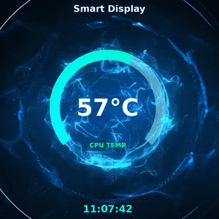
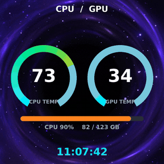
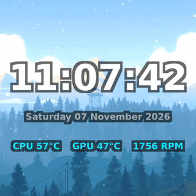

# xigmalcd — system stats on the Xigmatek Connect AIO's built-in LCD


Linux counterpart of the Windows `ALPHA` app that ships with Xigmatek **Connect**
series AIO coolers. Those coolers have a 480×480 LCD in a USB port header on the
water block; on Windows the vendor app draws CPU/GPU temps, clocks and fan speeds on
it. On Linux the panel shows up as a plain CDC-ACM serial port (`/dev/ttyACM0`) and
nothing talks the protocol — until now.

This repo draws the same information from Linux sensors and pushes it to the panel as
PNG frames. Verified on real hardware (Connect 360, firmware `V1.2.3`): handshake,
metrics blob and picture upload all work from Kubuntu — the drawn frame is what the
display shows.

**Unofficial, and it says so.** Nothing here is affiliated with, endorsed by or
approved by XIGMATEK; `Xigmatek`, `Connect` and `ALPHA` are their owner's names. The
code — `xigmalcd/`, `xigmaui/`, `tools/`, `install/` — is GPL-3.0-or-later (`LICENSE`),
and the vendor's own files this repo carries as evidence and test assets are labelled
as such wherever they appear ("Licence", at the end).

## What it draws

The five previews below **play**: our transparent OSD layer composited over a clip from
the vendor's own library, running on repeat — the same two-layer picture the panel puts on
the glass, and the same kind of loop whose restart seam PROTOCOL.md §9 measures there.
Each theme runs over a *different* background, so the five show the skin against five
moving pictures instead of the same picture five times. All five clips are in this
repository, so regenerating them from a clone gives you what is below.

| `alpha` (default) over `Theme_25.mp4` | `gauge` over `3.mp4` |
|---|---|
|  |  |

| `dual` over `Theme_30.mp4` | `clock` over `Theme_07.mp4` |
|---|---|
|  |  |

| `bars` over `theme_52.mp4` | |
|---|---|
|  | |

They are GIFs because GitHub renders an `.mp4` in a README as an `` no browser
plays, so motion here has to be a GIF. `tools/preview_gif.py` writes them through the
same path the window's preview pane uses — `clips.ClipPlayer` decoding the file,
`render.draw` drawing our layer over it — at 320 px, 12 frames, a 170 ms delay, 128
colours, and the total for all six figures in the tree is 2 269 716 B. What is *not*
live: the readings are one pinned set, `tools/preview_pin.py`, the same one the still
previews use, so the picture says the same thing on every machine — 57 °C CPU and 47 °C
GPU, CPU load 42 %, 83 of 123 GB of memory, fans 1 957 and 1 554 RPM. 57 °C is
deliberate: the gauge theme's scale is 30..75 °C, measured off the vendor's layout, so
the arc sits at 60 % of the sweep, in the part of the ramp where colour changes. This
bench's *live* number is not that — 73 °C at 89.8 % under eight parallel ffmpeg decodes,
70 °C at 8.8 % with a GPU-using process running — and at 73 °C that arc would sit at
95.6 % of the sweep, which reads as pegged rather than as a measurement. Both live
readings are written down beside the fixture, and `--live` draws them.

A scrim plate is part of the same picture: the tool applies the window's own auto rule
(150/255 of dark plate over a clip measured brighter than mid-grey), which is why the
`clock` preview over `Theme_07.mp4` — mean luma 176.3 of 255, white glyphs on a bright
field — carries one and the four dark backgrounds do not. Counted out of the encoded
files, glyph against the halo the plate hugs: `alpha` 154.3, `dual` 127.4, `gauge` 113.1,
`clock` 110.3, `bars` 92.6 on a 0-255 scale, where the `clock` figure is 47.1 without the
plate and the glyph itself is 241.8 either way — the plate darkens the ring around the
text, it does not brighten the text. The suite holds that at a floor of 30 and prints all
five every run, and it checks each file is over the background its caption names: the
theme's untouched pixels against the clip's own mean luma, gaps of 0.4 to 10.4.

And because a GIF carries a length, the restart is worth measuring rather than trusting.
By PROTOCOL.md §9's own metric — mean absolute difference of the gray plane — each GIF's
join is compared with what the *same clip* does over the same sampled span, because that
is the only claim a preview can honestly make: the layer must not add a jump the video
underneath does not have.

| background | its own join vs a typical step | the GIF over it |
|---|---|---|
| `Theme_25.mp4` (0.96 s loop, 24 fps) | 2.60 / 2.68 | 2.32 / 2.35 |
| `3.mp4` (2.10 s, 20 fps) | **12.34** / 9.25 | **11.19** / 7.24 |
| `Theme_30.mp4` (5.42 s, 24 fps) | 2.83 / 0.92 | 2.30 / 0.77 |
| `Theme_07.mp4` (17.62 s, 24 fps) | 0.61 / 0.44 | 0.54 / 0.41 |
| `theme_52.mp4` (10.10 s, 20 fps) | **13.52** / 2.90 | **10.78** / 1.87 |

Why a restart looks the way it does depends on how much of the loop the GIF covers, and
two of these five are the interesting cases. `3.mp4` loops in 2.10 s and the GIF runs
2.04 s, so its restart is the clip's own join — and that is a hard cut, 12.34 against 9.25
sampled and 12.45 against 4.55 measured at the clip's native 20 fps
([docs/limits.md](docs/limits.md)); the `gauge` preview above jumps because the video
under it jumps. `theme_52.mp4` is the other case: its loop is 10.10 s and its own join is
mild (2.49 against 1.29 typical), but a 2.04 s GIF of it restarts 1.9 s into the clip, so
what the reader sees is a cut back to the beginning — 13.52 — because that is how much the
clip moves in two seconds. Neither is the compositing: the same span of the same clip, with
nothing drawn on it, gives the numbers in the middle column, and the layer is held to them
by the suite. The GIF palette is ffmpeg's, not the 256-colour PNG the panel is fed;
measured back out of the encoded files, the drawn colours land 0-2 per channel from what
`render.py` asked for, and the amber figure in [docs/gui.md](docs/gui.md) holds
(253, 195, 1) against the `#ffc400` asked for, 2/255.

A word for readers who cannot see the motion: GitHub documents that animated GIFs follow
the reader's system reduced-motion preference by default, under
**Settings → Accessibility → Motion → "Autoplay animated images"**
([Managing accessibility settings](https://docs.github.com/en/account-and-profile/how-tos/account-settings/managing-accessibility-settings)),
so these five may reach you as a still frame. The files themselves loop for ever
(`loop = 0` in each, asserted by the suite), the first frame of each is a real composited
frame rather than a fade-in, and the alt text above says what each picture shows — which
is what has to carry the description when the motion does not.

`alpha` is the vendor's currently selected theme redrawn widget for widget, with the
things that theme has no widget for added: a GPU-temperature column, a gauge arc
around each temperature (30-100 °C, position *and* colour carrying the value), a clock
with seconds, and one fan figure under each temperature. [docs/themes.md](docs/themes.md)
has the identity claim, the geometry and why the digits are that size;
[`themes/alpha/`](themes/alpha) holds the vendor's whole library — 27 themes, their
decrypted layouts, their clips and their baked overlays, every byte hashed — and the
contact sheet of it is
[`docs/previews/alpha-themes-480X480.png`](docs/previews/alpha-themes-480X480.png).

## The window

The same controls in a Qt application: pick a theme, pick a background from every clip
the machine can find, watch the preview, put one frame or the whole loop on the glass.
And because this panel cannot be asked what it is showing, the window says what it
*knows*: the background the running display reported putting there, and the last six
things it did on the port. Three columns — preview, controls, clip library — with an
`advanced controls` switch that folds the secondary knobs away without changing their
values, a `playing` box that decodes the background in sequence so the preview moves
under our layer instead of showing one still frame of it, and one row that is always in
sight, for the colour of the text it draws. This is a capture of the real program
(`tools/screenshot.py`, no panel attached), with this machine's live readings in the
preview:


It talks to a display loop that is already running when one is running, and drives the
port itself when nothing is — which is the part that needs care, because the panel
allows exactly one opener. [docs/gui.md](docs/gui.md) is the whole write-up: what every
button sends on the wire, what the window stores between runs, what it costs to run,
and the glass ledger for it with the log file each number came from.

## Quick start

### 1. Debian, Kubuntu, Ubuntu: install the `.deb` files

```bash
# 1. get the two files - the releases page in a browser, or with gh:
gh release download --latest --pattern '*.deb'
# 2. install both from one command line (building them instead is docs/packaging.md):
sudo apt install ./xigmatek-connect-lcd_*_all.deb ./xigmatek-connect-lcd-themes_*_all.deb
# 3. the udev rule is installed but not read yet - replug, or:
sudo udevadm control --reload-rules && sudo udevadm trigger --action=change
# 4. the install *enables* the unit and does not start it:
systemctl --user start xigmalcd.service
xigmaui                                     # the window; needs `sudo apt install python3-pyqt6`
```

That gives `/usr/bin/xigmalcd`, `/usr/bin/xigmaui` and `/usr/bin/xigmalcd-reset`, a
udev rule that makes the port a user-owned `/dev/xigmatek-lcd` and keeps ModemManager
off it, and a user unit whose `ExecStart` is `--theme alpha --fps 2` with no reset
permission. The second package is the vendor's own theme library and is optional on
purpose. Two things about that unit are worth knowing on day one: the install enables it
in systemd's **global user** scope (`/etc/systemd/user/default.target.wants`, so for every
user's next login - taking that back is `sudo systemctl --global disable xigmalcd`), and an
**upgrade** while you are logged in has been seen to start the display on its own three
seconds after apt finished. `systemctl --user stop xigmalcd` frees the port at any point.
Everything else an install does and does not do — including the udev reload above — is
measured and written down in [docs/packaging.md](docs/packaging.md), with the transcripts.

### 2. Any other Linux distribution: run it from this tree

```bash
python3 -m xigmalcd --list                    # find the port and its USB description
python3 -m xigmalcd                           # default theme, 1 fps, the vendor's cadence
python3 -m xigmalcd --fps 3 --clock-size 34   # tighter clock, bigger digits
python3 -m xigmalcd --dry-run /tmp/frames --once   # a PNG, and the port never opened
python3 -m xigmaui                            # the window (needs PyQt6)
python3 -m xigmalcd --status                  # ask the running display what it shows
```

Needs Python 3.9+, [pyserial](https://pypi.org/project/pyserial/) and
[Pillow](https://pillow.readthedocs.io/) — on a Debian-family box
`sudo apt install python3-serial python3-pil`. `/dev/ttyACM0` is `root:dialout`, so be
in that group or install the rule; both recipes, and how to run it at login on a
systemd-less machine, are in [docs/install.md](docs/install.md). The window's extra
dependency is PyQt6 (`pip install .[gui]`), which the display loop never needs.

The default run uploads the theme's background first (`media/Theme_25.mp4`, 215 KB) and
then draws on a **transparent** canvas, so that background keeps playing behind the
picture — which is how the vendor's own app does it, and the pair is what its own config
names, so the default glass is what `ALPHA` showed you on Windows.

## Where the detail lives

| | |
|---|---|
| [docs/install.md](docs/install.md) | requirements, the port and the udev rule, `pip install`, running it at login |
| [docs/usage.md](docs/usage.md) | every `xigmalcd` flag, what goes on the wire and when, one port between two processes |
| [docs/gui.md](docs/gui.md) | the window: controls, what each action sends, settings, cost, glass runs |
| [docs/themes.md](docs/themes.md) | what `alpha` is a redraw of, the ring geometry, the vendor library |
| [docs/packaging.md](docs/packaging.md) | the two `.deb` files, `lintian`, CI, install transcripts, reproducible builds |
| [docs/tools.md](docs/tools.md) | what every script in `tools/` is for, and which question it answers |
| [docs/limits.md](docs/limits.md) | what has been seen on glass, by whom, in how many frames — and what has not |
| [docs/troubleshooting.md](docs/troubleshooting.md) | a panel stuck white, and the one command that brings it back |
| [PROTOCOL.md](PROTOCOL.md) | the wire: the handshake, the frame format, the media upload, the session limit — every claim from a capture |

Everything in those files is measured on the author's bench or read out of a kept log,
and the gaps are named as gaps. `tools/selftest.sh` runs the twenty offline sections
that hold the claims which do not need hardware — it is what CI runs first, on a machine
that has never seen a panel.

## How the protocol works

See **[PROTOCOL.md](PROTOCOL.md)** — frame format, the checksum rule, the vendor's
escaping (`0x5A` → `5B 01`, `0x5B` → `5B 02`, counted nowhere), how replies are matched
to requests (`AckNumber = SeqNumber + 1`), the command set, the upload sequence, the
session limits, and how to read the vendor app yourself. It is written out of captures of
the Windows app talking to this panel, and the offline suite re-checks that code against
those same captures: **181** host→panel frames re-encoded with **0** disagreeing with
`xigmalcd/protocol.py`, and **267** replies read against the checksum rule with all of
them passing.

`xigmalcd/protocol.py` is the implementation; `xigmalcd/sensors.py` reproduces the
metrics schema; `xigmalcd/render.py` is the drawing; `xigmalcd/main.py` is the loop;
`xigmaui/` is the Qt window over the same four modules.

## Licence

GPL-3.0-or-later for the code, with the vendor's own files carved out and labelled
where they came from. [LICENSE](LICENSE) is the license text;
[debian/copyright](debian/copyright) is the machine-readable version of the same
distinction, and it names what was done to obtain the vendor's files rather than
pretending to license them. If the rights holder of XIGMATEK's files considers their
inclusion wrong, say so at the address in that file's `Upstream-Contact` and they come
down.

## Credit

The protocol was recovered by watching the Windows app talk to a panel that this
project then drove from Linux; the notes on how, and the captures themselves, are in
[PROTOCOL.md](PROTOCOL.md). [docs/handoff-2026-11-05.md](docs/handoff-2026-11-05.md) is
the record of how that discovery went, kept as history rather than as current state.
